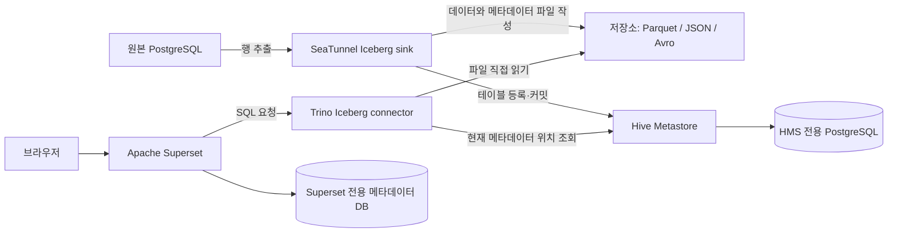

# 로컬 데이터 레이크하우스 구축: SeaTunnel · Iceberg · Hive Metastore · Trino · Superset

작성일: 2026-10-06. 이 문서는 **변경된 목표 구조와 구축 절차를 설명하는 설계 안내서**다.
기존 저장소의 파일과 실행 증거를 확인하고 공식 문서를 대조했다. Trino 483은 2026-10-06 실제 조회 검증을 완료했다. Superset 6.0.0도 2026-10-07 연결했다. [Superset 실행 안내](superset-local-ui.md)를 참고한다. [Trino 실행 안내](trino-local-query.md)를 우선 참고한다.

[그림으로 보는 환경 배치·실제 적재·웹 조회 흐름](md/local-lakehouse-flow.md)에서 PNG 3장과 설명을 함께 볼 수 있다.

## 1. 이번에 구축할 구조

**적재는 SeaTunnel Iceberg sink, 테이블 형식은 Iceberg, 카탈로그는 Hive Metastore, SQL 실행은 Trino, 웹 조회는 Superset으로 구성한다.**

Superset은 SQL을 실행할 데이터베이스/쿼리 엔진에 연결하는 BI 웹 애플리케이션이다. Iceberg는 SQL 서버가 없는 테이블 포맷이다. 따라서 이 구성에서 Superset을 Iceberg 파일이나 HMS Thrift 주소에 직접 연결하는 방식으로 쿼리 엔진을 생략할 수는 없다. Superset이 지원하는 Trino 연결을 사용하고, Trino의 Iceberg 커넥터가 테이블을 읽게 한다. 다른 SQL 엔진도 선택할 수 있지만 이 문서는 Trino로 통일한다. [Superset 개요](https://superset.apache.org/docs/), [Superset 데이터베이스 연결](https://superset.apache.org/user-docs/6.0.0/configuration/databases/)



쓰기 흐름은 `원본 DB → SeaTunnel → Iceberg 파일 작성 + HMS 커밋`이다.
조회 흐름은 `브라우저 → Superset → Trino → HMS에서 위치 확인 → 저장소 읽기 → 결과 반환`이다.
그림의 화살표는 요청/접근 방향이며, 실제 조회 결과는 역방향으로 돌아온다.

| 구성요소 | 맡는 일 | 맡지 않는 일 |
|---|---|---|
| SeaTunnel | 추출·이관, 필요 시 transform, Iceberg 커밋 | 웹 분석 화면 제공 |
| Iceberg | 스키마·스냅샷·파일 집합을 테이블로 관리 | 독립 SQL 서버 실행 |
| 저장소 | Parquet와 Iceberg JSON/Avro 영속 보관 | SQL 계산 |
| Hive Metastore | namespace·테이블·속성·현재 metadata 위치 관리 | 주문 행을 읽어 SQL 결과 반환 |
| Trino | Iceberg 해석, 파일 읽기, 필터·조인·집계 | 대시보드 관리 |
| Superset | SQL Lab, Dataset, 차트·대시보드 | Iceberg 파일에 직접 SQL 실행 |

“sink를 Iceberg로?”에 대한 답은 **맞다**. 기존 `LocalFile` sink로 Parquet만 내보내는 대신 `Iceberg` sink를 사용해야 파일 생성과 테이블 커밋을 함께 처리한다. 이 저장소는 이미 그 방식이다. `add_files()`를 추가 적재 단계로 넣을 필요가 없다. [기존 job](../jobs/01_orders_to_iceberg.conf), [SeaTunnel 2.3.13 Iceberg sink](https://seatunnel.apache.org/docs/2.3.13/connectors/sink/Iceberg/)

현재 실습은 배치 추출·적재와 Trino 조회까지다. ELT의 적재 후 변환 결과를 별도 테이블에 저장하는 단계는 아직 없다. 먼저 웹 조회를 완성하고, 지속적인 변환 테이블 작성과 CDC는 후속 범위로 다룬다.

## 2. 기존 구현에서 이어받는 것

| 항목 | 저장소에서 확인한 상태 | 새 목표에서의 처리 |
|---|---|---|
| SeaTunnel | 2.3.13, Zeta, Iceberg sink | 유지 |
| 테이블 | Iceberg format v2, Parquet, `retail.orders` | 유지하거나 별도 저장소에 새 테이블로 재적재 |
| HMS | Hive 4.0.1, `thrift://hms:9083` | 유지 |
| HMS DB | `catalog-db`, PostgreSQL 16 | 유지 |
| 원본 DB | `source-db`, PostgreSQL 16 | 유지 |
| 저장소 | 호스트 `./lake` → 컨테이너 `/lake` | 로컬 파일 호환성 확인 후 재사용 |
| Trino 483 | compose.analytics.yaml에 구현·검증 완료 | 기존 HMS·로컬 파일 조회 |
| Superset 6.0.0 | 연결 완료 | 주문 Dataset·차트·대시보드 |

[compose.yaml](../compose.yaml), [원본 데이터](../evidence/source-orders.txt), [HMS 기록](../evidence/02-hms.txt)을 참고한다. 기존 보조 조회 산출물은 제거했다.
기존 검증은 첫 배치 3건/69,000, 두 번째 배치 후 5건/170,000, 과거 스냅샷 3건 및 HMS/DB 재시작 보존까지다. **현재 5건/170000 및 첫 스냅샷 3건/69000은 Trino에서도 확인했다. Superset 결과는 아니다.**

`scripts/up.sh`는 `catalog-tools`로 HMS namespace를 준비한다. 기존 보조 조회·배치 검증 코드와 배치 실행 래퍼는 삭제했다. 새 조회 및 적재 전후 검증은 Trino로 구현해야 한다.

## 3. 메타데이터와 저장소 구분

| 저장 위치 | 내용 | 보존 대상 |
|---|---|---|
| HMS PostgreSQL | 테이블 등록·속성·현재 metadata 포인터 등 | `catalog-db` 볼륨 |
| Iceberg metadata JSON | 스키마, 파티션 정의, 스냅샷 정보 | 레이크 저장소 |
| manifest list / manifest | 스냅샷별 파일 목록·통계 | 레이크 저장소 |
| Parquet | 실제 업무 데이터 행 | 레이크 저장소 |
| Superset PostgreSQL | 연결 설정, Dataset 정의, 차트, 대시보드, 사용자 등 | 별도 `superset-db` 볼륨 |

Superset의 **Dataset 등록은 Iceberg 데이터 복사가 아니다**. UI가 어떤 테이블을 어떤 컬럼·지표로 조회할지 정의한다. Superset 자체 메타데이터 DB와 분석 대상인 Trino 연결도 서로 다르다. [Superset 아키텍처](https://superset.apache.org/admin-docs/6.1.0/installation/architecture/)

HMS DB만 백업하거나 Parquet만 복사하는 것으로 전체 상태가 보존되지는 않는다. 기존 metadata JSON/manifest가 참조하는 파일과 카탈로그 상태를 함께 유지해야 한다.

## 4. 먼저 결정할 것: 기존 로컬 파일을 그대로 읽을 수 있는가?

현재 실제 HMS 포인터와 manifest에는 **`file:/lake/...`**가 들어 있다. 설정 입력의 `file:///lake/...`와 표기는 다르지만 기존 Hadoop writer가 만든 로컬 파일 URI다.

### A. 기존 공유 디렉터리 재사용 — 검증 완료

Trino 483을 단일 coordinator/worker로 실행하고 `./lake:/lake:ro`를 마운트했다. 아래 설정으로 기존 `file:/lake/...`를 변경 없이 읽었다.

```properties
connector.name=iceberg
iceberg.catalog.type=hive_metastore
hive.metastore.uri=thrift://hms:9083
iceberg.security=READ_ONLY
fs.local.enabled=true
local.location=/
```

`local.location`은 파일시스템 루트 경로이며, 기존 URI의 `lake/...`와 결합된다. 이전의 `local:///lake` 예시는 사용하지 않는다. 목록 조회뿐 아니라 실제 5건과 과거 스냅샷을 조회했다. 설정 근거와 SQL 결과는 [Trino 실행 안내](trino-local-query.md)에 정리했다.

### B. 로컬 S3 호환 저장소 — A의 URI 호환이 맞지 않을 때 권장

로컬 머신에서 MinIO 같은 S3 호환 저장소를 실행하고 SeaTunnel·Trino가 같은 `s3://lakehouse/...` 주소를 쓰게 한다. 클라우드 계정이 필수인 것은 아니다. 저장소의 실제 데이터는 로컬 Docker 볼륨에 남고 접근 방식만 S3 API로 바뀐다.

이 경우 추가 서비스와 SeaTunnel S3 의존성 준비가 필요하지만 엔진 간 로컬 URI 차이를 피할 수 있다. 구체 설정은 [구축 선택지와 저장소 전환](local-lakehouse-build-options.md)에 정리했다. 이번 문서에서는 기존 데이터 보존을 위해 새 namespace `retail_s3`를 예시로 쓴다.

**`warehouse` 설정만 바꾸면 기존 테이블이 이동하는 것은 아니다.** 기존 `retail.orders`는 이전 location과 manifest 경로를 유지한다. A가 실패하여 B로 전환할 때는 기존 테이블을 남겨두고 새 namespace에 원본 데이터 5건을 새로 적재하여 검증한다. 과거 스냅샷까지 옮기는 마이그레이션은 별도 작업이다.

## 5. 서비스 배치와 네트워크

Trino는 `compose.analytics.yaml`에 추가했다. Superset도 구현했으며 옵션 B 저장소만 설계 단계다.

| 서비스 | 컨테이너 간 주소 | 호스트 접근 예시 | 비고 |
|---|---|---|---|
| SeaTunnel | 원본 DB, HMS, 저장소로 연결 | 보통 불필요 | 배치 실행 컨테이너 |
| HMS | `hms:9083` | 기본 비공개 | HiveServer2/REST 불필요 |
| Trino | `trino:8080` | `127.0.0.1:8081:8080` | 단일 노드로 시작 |
| Superset | `superset:8088` | `127.0.0.1:8088:8088` | 브라우저 진입점 |
| Superset DB | `superset-db:5432` | 비공개 | HMS DB와 분리 |
| S3 저장소(옵션 B) | 예: `minio:9000` | 필요할 때만 공개 | bucket과 볼륨 준비 |

모두 `iceberg-learning-net`에서 서비스 이름으로 통신하도록 구성한다. 별도 Compose를 쓴다면 이 네트워크를 external network로 연결한다. Superset 컨테이너에서 `localhost:8080`은 Trino가 아니다.

Trino의 catalog 이름 `iceberg`는 **`iceberg.properties` 파일명**에서 정한다. SeaTunnel의 `catalog_name = "local_hive"`와 이름을 맞출 필요는 없다. 두 엔진이 같은 HMS와 테이블/저장소를 바라보는 것이 중요하다. 따라서 SQL의 전체 이름은 다음과 같다.

```text
iceberg.retail.orders
└ catalog  └ schema (= HMS namespace)  └ table
```

## 6. 구현 순서

### 6-1. 현재 상태 확인 및 적재 준비

기존 데이터가 있으면 배치를 다시 실행하지 않는다. 새 환경을 처음 준비하는 경우에만 기존 절차를 사용한다.

```sh
# 저장소 루트에서 실행: 기존 로컬 파일 실습 환경을 만드는 명령
bash scripts/up.sh
```

위 명령은 서비스와 namespace만 준비하며 데이터를 적재하지 않는다. 기존 원시 job은 `jobs/01_orders_to_iceberg.conf`, `jobs/02_orders_to_iceberg.conf`에 남아 있지만 `APPEND_DATA`는 행 중복을 막지 않는다. 기존 배치 래퍼와 중복 검사 도구는 제거했으므로, 이미 적재된 테이블에 재실행하지 않는다. 새 배치 실행 전 Trino 기반 선행 상태 검사와 적재 후 검증을 준비한다.

### 6-2. Trino를 먼저 검증

Trino 이미지 태그를 고정하고, 단일 노드 서버 설정과 위의 catalog 설정을 준비한다. 공식 문서 조사 시 `current`는 Trino 483이었다. 해당 버전의 HMS·기존 로컬 파일 조회는 실제 검증했다. 구버전을 선택하면 그 버전의 설정 이름을 다시 확인한다.

Superset 연결 전에 Trino CLI 등으로 다음을 실행한다. S3 대안을 선택했다면 아래 `retail`을 `retail_s3`로 바꾼다.

```sql
SHOW CATALOGS;
SHOW SCHEMAS FROM iceberg;
SHOW TABLES FROM iceberg.retail;
DESCRIBE iceberg.retail.orders;
SELECT * FROM iceberg.retail.orders ORDER BY order_id;
SELECT count(*) AS row_count, sum(amount) AS total_amount
FROM iceberg.retail.orders;
```

기존 두 배치를 마친 테이블을 재사용하거나 동일한 5건을 새로 적재했다면 기대값은 **5 / 170000**이다. 목록 조회 성공만으로 파일 읽기가 확인되지는 않는다.

Trino는 `connector.name=iceberg`를 사용한다. 카탈로그가 Hive Metastore라고 해서 일반 Hive 커넥터로 설정하지 않는다. `iceberg.security=READ_ONLY`는 이 실습의 조회용 Trino에서 테이블 쓰기를 제한한다. SeaTunnel의 별도 커밋 경로에는 영향을 주지 않는다. [Trino Iceberg 커넥터](https://trino.io/docs/current/connector/iceberg.html)

### 6-3. Superset 실행 환경 준비

1. Superset 릴리스 이미지 태그를 고정한다. Trino Python 드라이버와 Superset 메타데이터 DB용 PostgreSQL 드라이버를 **Superset을 실행하는 Python 환경**에 설치한 파생 이미지를 준비한다. 호스트 Python에 설치하는 것으로 컨테이너에 반영되지는 않는다.
2. Superset 전용 PostgreSQL DB/계정/볼륨을 준비한다.
3. `superset_config.py`에 `SECRET_KEY`와 `SQLALCHEMY_DATABASE_URI`를 환경변수에서 읽도록 설정하고, 설정 파일을 마운트한 뒤 `SUPERSET_CONFIG_PATH`로 지정한다.
4. 동일한 이미지·설정으로 DB 마이그레이션, 관리자 생성, 권한 초기화를 순서대로 실행한다.
5. 웹 서버를 시작하고 `http://localhost:8088`에 로그인한다.

```python
# superset_config.py 설계 예시
import os
SECRET_KEY = os.environ["SUPERSET_SECRET_KEY"]
SQLALCHEMY_DATABASE_URI = os.environ["SUPERSET_METADATA_DB_URI"]
# SUPERSET_METADATA_DB_URI 예시 형식:
# postgresql+psycopg2://superset:<password>@superset-db:5432/superset
```

```sh
# Superset 컨테이너의 Python 환경에 포함할 패키지
pip install 'trino[sqlalchemy]' psycopg2-binary

# 같은 컨테이너 환경·설정에서 최초 초기화
superset db upgrade
superset fab create-admin
superset init
```

위는 초기화 순서 설명이다. 현재 구현된 전체 설치 스크립트는 `bash scripts/up-superset.sh`다. 이미지가 `/app/.venv`와 `uv`를 사용한다면 그 가상환경에 설치한다. 의존성 버전은 선택한 Superset 릴리스와 함께 고정한다. 비동기 SQL·알림·예약 보고서를 도입할 때는 Redis/Celery worker 등의 구성을 추가한다. 첫 목표는 동기 SQL Lab 조회와 기본 차트다. [Superset 설치](https://superset.apache.org/docs/installation/pypi/), [Docker 이미지와 드라이버](https://superset.apache.org/admin-docs/installation/docker-builds/)

### 6-4. Superset에서 Trino 연결

Superset의 Database Connections에서 Trino 연결을 추가한다. 메뉴명은 버전에 따라 달라질 수 있다. 같은 Docker 네트워크의 인증 없는 로컬 Trino 예시는 다음과 같다.

```text
trino://superset@trino:8080/iceberg
```

여기서 `superset`은 Trino 요청 사용자 이름이다. Superset 웹 로그인 계정/비밀번호를 뜻하지 않으며, 이 예시는 Trino 인증을 구성한 것이 아니다. Trino 인증을 켰다면 그 방식에 맞는 인증 정보를 설정한다.

연결 테스트 → 저장 → SQL Lab에서 연결 선택 → schema `retail` 선택 → SQL 실행 순서로 진행한다. `catalog-db`에 PostgreSQL 연결을 등록해도 Iceberg의 주문 데이터가 조회되는 것은 아니다. [Superset Trino 연결 형식](https://superset.apache.org/user-docs/6.0.0/configuration/databases/#trino)

### 6-5. Dataset과 차트 만들기

SQL Lab에서 먼저 아래 결과를 확인한다.

```sql
SELECT status, count(*) AS order_count, sum(amount) AS total_amount
FROM iceberg.retail.orders
GROUP BY status
ORDER BY status;
```

| status | order_count | total_amount |
|---|---:|---:|
| DONE | 3 | 113000 |
| NEW | 2 | 57000 |

이후 Dataset으로 `retail.orders`를 등록하고, 막대 차트의 차원에 `status`, 지표에 `SUM(amount)`를 지정한다. 저장한 차트를 대시보드에 추가한다. S3 대안이면 동일한 과정에서 `retail_s3.orders`를 사용한다.

## 7. 스냅샷과 추가 적재 확인

기존 로컬 테이블을 재사용할 경우 Trino에서 다음으로 과거 기록을 조회할 수 있는지 확인한다.

```sql
SELECT snapshot_id, parent_id, operation, committed_at
FROM iceberg.retail."orders$snapshots"
ORDER BY committed_at;

-- 기존 evidence에 기록된 첫 스냅샷 ID. 새 테이블에는 이 ID를 재사용하지 않는다.
SELECT count(*)
FROM iceberg.retail.orders FOR VERSION AS OF 2162422063555107563;
```

기존 파일·스냅샷이 보존되어 있다면 과거 count의 기대값은 3이다. 새 테이블은 `$snapshots`에서 실제 ID를 얻어 사용한다. [Trino Iceberg 스냅샷/시간 여행](https://trino.io/docs/current/connector/iceberg.html)

추가 적재 시험은 별도 배치 ID/중복 방지 기준을 정한 뒤 수행한다. SeaTunnel 커밋 → Trino에서 새 SQL 실행 → Superset SQL Lab 재실행 → 차트 새로고침 순으로 확인한다. 차트 캐시가 있으면 이전 결과가 표시될 수 있으므로 먼저 SQL Lab 결과와 비교한다.

## 8. 자주 막히는 지점

| 증상 | 우선 확인할 사항 |
|---|---|
| Superset에 Trino 연결이 안 보임/드라이버 import 오류 | 실행 컨테이너의 Python 환경에 Trino 드라이버 설치 여부 |
| Superset → Trino 접속 실패 | 같은 Docker 네트워크, `trino:8080`, Trino 서버 준비 상태 |
| schema/table 목록 조회 실패 | HMS Thrift 연결과 선택한 Trino/Hive 4 조합의 API 호환성 |
| 테이블은 보이지만 `SELECT` 실패 | 파일시스템 활성화, `file:` URI 지원, 경로·권한 또는 S3 인증 |
| 일부 파일만 못 읽음 | manifest 내부 절대 URI와 실제 저장소 위치 |
| 새 데이터가 안 보임 | SeaTunnel 커밋 성공, 대상 namespace 일치, Trino/차트 캐시 |
| 재시작 뒤 차트/연결이 사라짐 | Superset 전용 DB 볼륨과 동일한 SECRET_KEY 유지 여부 |
| 재시작 뒤 테이블을 못 찾음 | HMS DB 볼륨과 레이크 저장소 모두 보존했는지 |

기존 Python 조회용 HMS API 우회 코드는 함께 제거했다. Trino 483/HMS 4.0.1 조합의 테이블 탐색과 파일 읽기는 검증했다.

## 9. 구축 완료 기준과 남은 작업

- [x] 저장소 경로 A의 `file:` 호환 확인 또는 B의 새 S3 테이블 적재 완료
- [x] SeaTunnel → Iceberg → HMS 커밋 성공
- [x] Trino에서 테이블 목록과 실제 행 읽기 성공
- [ ] Superset SQL Lab에서 5건, 합계 170000 확인
- [ ] Dataset 등록, 상태별 금액 차트, 대시보드 저장
- [ ] 서비스 재시작 후 테이블과 대시보드 보존 확인
- [ ] 버전·설정·로그·조회 결과를 새 실행 증거로 기록

현재 완료된 것은 **문서 조사·설계 정리**와 기존 적재·카탈로그·보조 조회 검증이다. Trino용 Compose·설정·CLI·조회 검증을 완료했다. Superset 파생 이미지·전용 DB·초기화·차트 구현이 남아 있다. 기존 로컬 경로 조회에 성공했으므로 S3 이전은 필요하지 않았다. CDC UPDATE/DELETE, 동시 writer, 장애 복구, 성능 시험은 위 완료 기준 이후에 진행한다.

## 10. 문서 읽는 순서

1. **이 문서**: 현재 목표와 전체 구축 순서.
2. [구축 선택지](local-lakehouse-build-options.md): 공유 디스크와 로컬 S3, 설정 차이.
