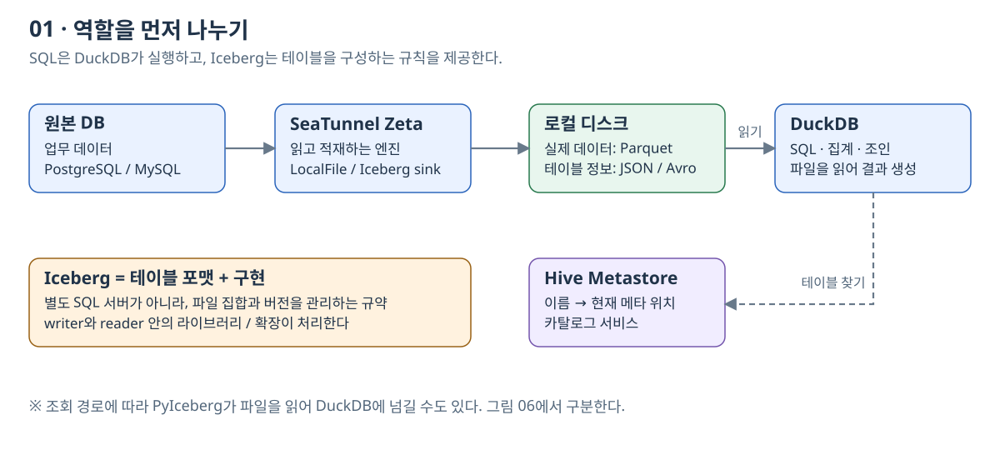
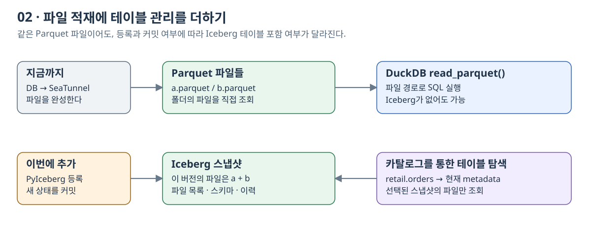
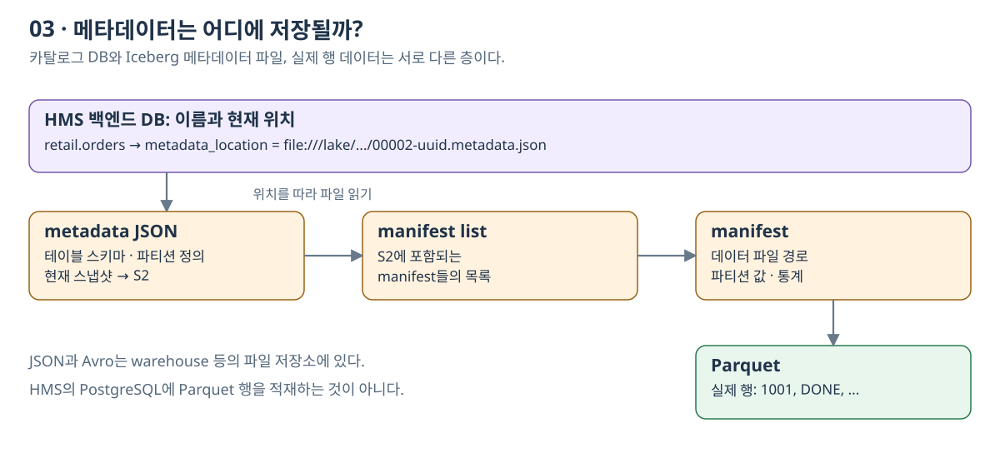
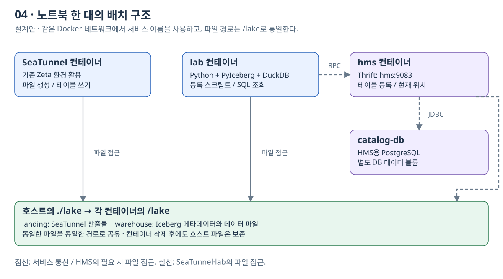
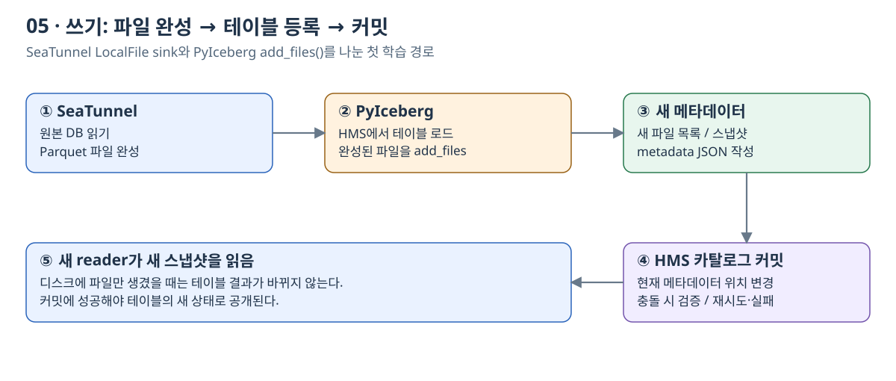
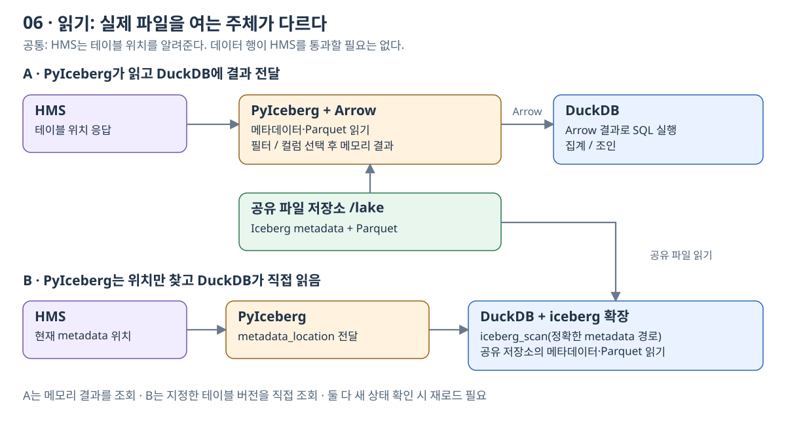
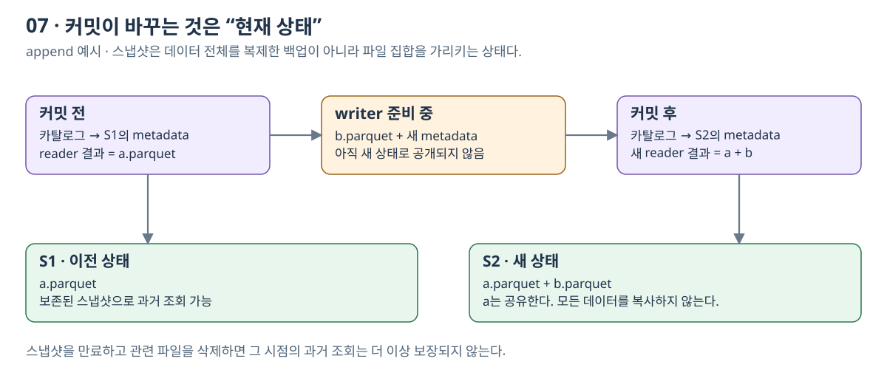
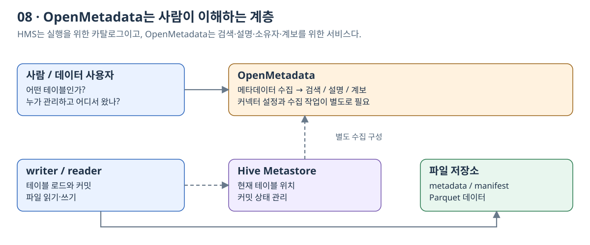

# 그림으로 이해하는 로컬 레이크하우스

> SeaTunnel로 DB → Parquet을 만들어본 사람을 위한 Iceberg · Hive Metastore · DuckDB 안내서
>
> 검토일: 2026-10-02. 기존 조사 문서 2개와 공식 문서를 대조한 **개념·설계 검증**이다. 컨테이너 실행 및 조합별 통합 테스트를 완료했다는 뜻은 아니다. 예제 경로와 파일명은 설명용이다.

## 1. 질문에 먼저 답하면

**맞다. Iceberg 자체를 DB 서버처럼 Docker로 띄우는 것은 아니다.** Iceberg는 데이터를 테이블로 관리하는 **오픈 테이블 포맷**이며, 이를 읽고 쓰는 라이브러리와 엔진 연동 구현이 있다. Compose에 `iceberg`라는 이름의 서비스가 보이면, 실제 이미지가 실행하는 것은 Spark, REST 카탈로그 같은 주변 구성일 수 있다.

“Iceberg로 조회한다”는 말은 **DuckDB 같은 엔진이 Iceberg 형식의 테이블을 해석해서 SQL을 실행한다**는 뜻으로 이해하면 된다. Iceberg에 SQL을 보내고, Iceberg가 Hive를 거쳐 DuckDB에 일을 시키는 구조는 아니다. [Iceberg 소개](https://iceberg.apache.org/docs/latest/), [DuckDB Iceberg 확장](https://duckdb.org/docs/current/core_extensions/iceberg/overview)



| 구성요소 | 이 실습에서 맡는 일 | 어디에 존재하나? |
|---|---|---|
| 원본 PostgreSQL/MySQL | 업무 데이터의 출발점 | 기존 DB 서비스 |
| SeaTunnel Zeta | DB에서 읽고 파일로 적재 | 작업을 실행하는 엔진 프로세스 |
| Parquet | 실제 행과 컬럼을 저장하는 파일 형식 | 로컬 디스크의 파일 |
| Iceberg | 어떤 파일들이 한 테이블의 어떤 버전인지 정의 | 메타데이터 파일 + 이를 처리하는 구현 |
| Hive Metastore, HMS | 테이블 이름을 등록하고 현재 메타데이터 위치를 관리 | Java 서비스 + 백엔드 DB |
| DuckDB | SQL 필터·집계·조인 | Python, CLI 등에서 실행되는 임베디드 DB 엔진 |
| OpenMetadata | 사람이 데이터를 검색하고 설명·소유자·계보를 이해 | 별도 메타데이터 관리 서비스 |

DuckDB는 자체 DB 파일에 데이터를 저장할 수도 있다. **이번 구성에서는 외부 레이크를 조회하는 역할로 쓴다.** Python 전용도 아니다. CLI나 다른 언어에서도 사용할 수 있다. [DuckDB 개요](https://duckdb.org/docs/)

## 2. 이미 해본 작업에서 무엇이 추가될까?

지금까지는 `orders` 데이터를 Parquet 파일로 내보냈다. DuckDB는 이 파일을 바로 조회할 수 있으므로 **SQL 한 번 실행하는 데 Iceberg와 Hive가 반드시 필요한 것은 아니다.**

```sql
-- 일반 Parquet 파일 조회: 이 자체로 Iceberg 조회가 되지는 않는다.
SELECT status, count(*)
FROM read_parquet('/lake/landing/orders/*.parquet')
GROUP BY status;
```

일반 Parquet 조회도 컬럼 선택과 필터 푸시다운, 파일 내부 통계를 활용할 수 있다. Iceberg의 추가 가치는 **테이블 전체에 대한 일관된 파일 집합과 변경 이력**이다. [DuckDB Parquet 읽기](https://duckdb.org/docs/current/data/parquet/overview)



예를 들어 디렉터리에 `a.parquet`, `b.parquet`, 실패한 작업의 `temp.parquet`이 함께 있어도, Iceberg의 현재 스냅샷이 `a`, `b`만 가리키면 테이블 조회에는 둘만 들어간다. **파일의 존재와 테이블에 포함되는 것은 다르다.**

“레이크”는 파일을 쌓는 저장 기반에 가깝고, “레이크하우스”는 그 위에 테이블 관리와 SQL 분석 기능을 더한 아키텍처다. 이번 실습은 그 구조를 노트북 한 대에서 축소해서 배우는 것이다.

## 3. ‘메타데이터’는 세 종류로 나눠보자

가장 헷갈리는 문장이 “Hive에 메타데이터를 저장한다”다. 일부는 맞지만 **Iceberg의 메타데이터 파일 전체가 HMS의 PostgreSQL 안으로 들어가는 것은 아니다.**



| 위치 | 예시 | 답하는 질문 |
|---|---|---|
| HMS 백엔드 DB | `retail.orders`, 테이블 속성, `metadata_location` | 이 이름의 테이블은 어디에서 시작해서 읽나? |
| Iceberg metadata JSON | 스키마, 파티션 정의, 스냅샷 정보 | 어떤 구조와 버전을 읽나? |
| Manifest list / manifest | 파일 목록, 파티션 값, 통계 | 어떤 데이터 파일을 읽나? |
| Parquet 파일 | `order_id=1001, status='DONE'` | 실제 값은 무엇인가? |

HMS에는 포인터 외에도 namespace, 테이블 속성 등의 정보가 있다. “문자열 하나만 저장한다”는 표현은 핵심 역할을 설명하는 비유일 뿐 실제 저장 구조는 아니다. [Iceberg Hive 연동](https://iceberg.apache.org/docs/latest/hive/)

스냅샷은 데이터 전체를 매번 복사한 백업본이 아니다. 어느 파일 집합을 테이블의 한 시점으로 볼지 나타내며, 이전 스냅샷과 파일을 공유할 수 있다. 파일명과 디렉터리 배치는 구현에 따라 달라진다. [Iceberg 스펙](https://iceberg.apache.org/spec/)

```text
/lake/
├── landing/orders/batch-001.parquet    ← 기존 SeaTunnel 산출물
└── warehouse/retail/orders/
    ├── data/                          ← 새로 쓰는 데이터 파일의 예시 위치
    └── metadata/
        ├── 00001-<uuid>.metadata.json
        ├── snap-<id>-<uuid>.avro       ← manifest list
        └── <uuid>-m0.avro              ← manifest

HMS의 PostgreSQL 볼륨                  ← 위 파일들과 별도의 영속 데이터
└── 테이블 등록 정보와 현재 metadata_location
```

`add_files()`로 등록하면 manifest가 `landing`의 기존 파일을 가리킬 수 있다. 모든 데이터가 반드시 `warehouse/.../data`에 있어야 하는 것은 아니다.

## 4. 추천 학습 구성: 무엇을 Docker로 띄우나?

**HMS + 전용 PostgreSQL을 서비스로 실행하고, PyIceberg + DuckDB는 하나의 학습용 Python 컨테이너에서 실행하는 구성을 제안한다.** Python을 호스트에서 실행해도 되지만, 첫 실습에서는 컨테이너끼리 `/lake` 경로를 통일하면 이해하기 쉽다. 아래 그림은 구현 완료 상태가 아니라 설계안이다.



| Compose에서 관리할 대상 | 실행 형태 | 영속화할 것 |
|---|---|---|
| `hms` | 상주 서비스, Thrift 9083 | 설정; 실제 카탈로그 DB는 아래 PostgreSQL |
| `catalog-db` | HMS용 PostgreSQL 서비스 | DB 데이터 볼륨 |
| `lab` | PyIceberg + DuckDB가 설치된 Python 실행 환경 | `/lake` 공유 마운트 |
| SeaTunnel Zeta | 기존 환경 활용 또는 같은 네트워크의 별도 서비스 | 작업 설정·상태, `/lake` 공유 마운트 |

`iceberg-server`라는 프로세스는 필요 없다. HiveServer2, HDFS, Spark도 이 제안의 필수 요소가 아니다. HMS용 PostgreSQL과 업무 원본 PostgreSQL은 **역할과 데이터가 다르다**. 실습에서 같은 서버를 쓸 수는 있지만 DB와 계정을 분리하는 편이 구분하기 좋다.

연결에는 두 주소 체계가 있다.

```text
컨테이너 간 네트워크:   lab → thrift://hms:9083
호스트에서 네트워크:    Python → thrift://localhost:9083  (포트 공개 시)
파일 위치:             file:///lake/landing/orders/batch-001.parquet
```

컨테이너 안의 `localhost`는 그 컨테이너 자신이다. 기존 SeaTunnel이 별도 Compose 프로젝트에 있다면 공유 Docker 네트워크나 별도의 도달 가능한 주소를 설정해야 한다.

**같은 파일을 같은 절대 경로로 볼 수 있어야 한다.** 호스트의 `./lake`를 SeaTunnel과 `lab`에서 모두 `/lake`로 마운트한다. 파일 접근이 필요한 HMS 작업도 고려해 HMS에 같은 마운트를 둔다. 호스트 Python에서는 `/lake`가 저절로 생기지 않는다. 포트 연결이 성공해도 파일 경로가 다르면 읽기는 실패한다. S3/MinIO를 도입하면 공유 URI를 사용할 수 있지만, 첫 학습 단계에서는 서비스 수가 늘어난다.

## 5. 쓰기 흐름: Parquet이 테이블이 되는 순간



1. SeaTunnel이 원본 DB에서 데이터를 읽고 `batch-001.parquet`을 완성한다.
2. PyIceberg가 HMS에서 대상 테이블 정보를 읽는다. 최초 1회는 namespace와 테이블을 생성한다.
3. `add_files()`로 기존 Parquet을 등록한다. 데이터 파일을 다시 쓰지 않고 메타데이터를 만든다.
4. 새 metadata JSON이 준비되면 카탈로그 커밋을 수행한다.
5. 성공한 커밋을 통해 새 상태가 공개된다. 이후 새로 로드한 reader는 새 파일 집합을 본다.

PyIceberg의 `add_files()`는 스키마·필드 ID·이름 매핑 및 파티션 조건을 만족해야 한다. 처음에는 **파티션 없는 작은 append-only 데이터**를 권한다. 등록 후에는 원본 파일을 수정·이동·삭제하지 않는다. Iceberg 유지보수에 의해 삭제 대상이 될 수 있으므로 임시 출력 폴더나 다른 작업이 덮어쓰는 폴더를 그대로 사용하지 않는다. [PyIceberg 파일 등록](https://py.iceberg.apache.org/api/#add-files)

기존 조사에 있는 `add_files()` 예제는 “폴더 감시”가 아니다. 새 파일마다 등록 작업이 필요하며, 재실행 시 같은 배치를 다시 넣지 않도록 배치 추적도 필요하다. 같은 행을 다른 파일명으로 재적재하면 파일 중복 검사만으로 행 중복이 사라지지는 않는다.

후속 단계에서는 SeaTunnel **Iceberg sink**가 데이터 파일 생성과 메타데이터 커밋을 맡게 할 수 있다. LocalFile sink는 파일을 쓰고, Iceberg sink는 테이블에 커밋한다는 차이다. 2.3.13 공식 문서에 Hive/Hadoop/REST 관련 예제와 upsert 옵션이 있으나, Zeta의 실제 의존성 및 로컬 공유 경로 조합은 별도 실행 검증이 필요하다. [SeaTunnel 2.3.13 Iceberg sink](https://seatunnel.apache.org/docs/2.3.13/connectors/sink/Iceberg/)

## 6. 조회 흐름: 실제 Parquet은 누가 읽나?

**HMS는 일반적인 조회에서 Parquet 행을 전달하는 중계 서버가 아니다.** 테이블을 찾은 뒤 파일에 접근하는 것은 reader 쪽이다. 여기서 reader 구현을 두 가지로 나눌 수 있다.



### A. 이해하기 쉬운 첫 경로: PyIceberg → Arrow → DuckDB

PyIceberg가 HMS와 대화하고 Iceberg 테이블을 읽는다. 그 결과를 메모리의 Arrow 데이터로 DuckDB에 넘기고, DuckDB가 SQL을 실행한다. **이 경로에서는 실제 파일 읽기를 PyIceberg 쪽이 담당한다.** [PyIceberg DuckDB 연동](https://py.iceberg.apache.org/api/#duckdb)

```python
# 개념 예제: hms 연결, 공유 경로, 테이블, Python 패키지가 준비되어야 한다.
from pyiceberg.catalog import load_catalog

catalog = load_catalog(
    "local_hive",
    type="hive",
    uri="thrift://hms:9083",  # lab 컨테이너에서 실행할 때
)
table = catalog.load_table("retail.orders")
con = table.scan(
    row_filter="status = 'DONE'",
    selected_fields=("order_id", "status"),
).to_duckdb(table_name="orders")
print(con.sql("SELECT status, count(*) FROM orders GROUP BY status").fetchall())
```

이 방식은 DuckDB가 HMS 테이블을 영구적으로 `ATTACH`한 것이 아니다. 새 커밋을 보고 싶으면 테이블을 다시 로드하거나 refresh하고 scan을 다시 수행한다. 큰 데이터에서는 Arrow 결과의 메모리 사용량에 주의하고, 읽기 조건과 선택 컬럼을 PyIceberg scan에 미리 준다.

### B. DuckDB가 직접 읽기: 현재 메타데이터 위치만 PyIceberg로 찾기

PyIceberg를 **이름 → 현재 metadata 경로 조회**에만 쓰고, DuckDB의 `iceberg` 확장에 정확한 경로를 넘길 수 있다. 이때 Iceberg 메타데이터와 실제 Parquet을 읽는 주체는 DuckDB다. [DuckDB 직접 읽기](https://duckdb.org/docs/current/core_extensions/iceberg/overview)

```python
# 위 catalog와 테이블이 준비된 경우의 별도 조회 경로
import duckdb

table = catalog.load_table("retail.orders")
con = duckdb.connect()
con.execute("INSTALL iceberg")  # 최초 설치는 다운로드가 필요할 수 있음
con.execute("LOAD iceberg")
rows = con.execute(
    "SELECT status, count(*) FROM iceberg_scan(?) GROUP BY status",
    [table.metadata_location],
).fetchall()
print(rows)
```

이 예제는 실행 검증 전이며, 확장 버전과 파일 I/O 지원을 확인해야 한다. **파일명으로 최신 버전을 추측할 필요가 없고**, 불변인 metadata 경로 하나를 기준으로 읽는다. 이후 커밋까지 자동 추적하는 연결은 아니므로 다음 조회 때 카탈로그를 다시 로드한다. 이 경로로 쓰기 커밋을 수행하지는 않는다.

### 다른 연결 방법은 언제 보나?

| 연결 방식 | Iceberg 읽기 주체 | HMS와의 관계 | 학습 순서 |
|---|---|---|---|
| A. `to_duckdb()` | PyIceberg → Arrow | PyIceberg가 Thrift 사용 | 먼저 |
| B. `metadata_location` → `iceberg_scan()` | DuckDB 확장 | PyIceberg가 현재 경로만 조회 | 다음 |
| REST 카탈로그 `ATTACH` | DuckDB 확장 | REST를 제공하는 HMS 배포가 필요 | 버전 고정 후 검증 |
| `hive_metastore` 커뮤니티 확장 | 확장과 DuckDB reader | Thrift 연결; Iceberg 읽기 지원 | 대안으로 검토 |

DuckDB의 공식 `iceberg` 확장이 일반 HMS Thrift URI에 바로 연결하는 것과, 별도 커뮤니티 확장의 Thrift 연결은 구분해야 한다. REST `ATTACH` 경로의 쓰기는 현재 공식 문서에 지원되지만, 선택한 Hive 이미지와 DuckDB 확장의 조합은 테스트해야 한다. [DuckDB 카탈로그](https://duckdb.org/docs/current/core_extensions/iceberg/catalogs), [Iceberg 쓰기](https://duckdb.org/docs/current/core_extensions/iceberg/writing_to_iceberg), [커뮤니티 확장](https://duckdb.org/community_extensions/extensions/hive_metastore)

## 7. 커밋과 스냅샷을 그림으로 이해하기



S1이 `a.parquet`을 가리키고 있다고 하자. writer가 `b.parquet`과 S2 메타데이터를 만들고 있어도 아직 공개 전이면 새 reader는 S1을 읽는다. 커밋 후 새로 테이블을 로드하면 S2의 `a+b`를 읽는다. 기존 S1을 읽던 작업은 해당 파일이 유지되는 동안 일관된 이전 상태로 읽을 수 있다.

이 일관성은 **불변 파일, 커밋 검증, 카탈로그의 원자적 상태 변경, reader의 스냅샷 사용이 함께** 만든다. “HMS의 DB 트랜잭션 하나가 Iceberg의 모든 ACID를 만든다”라고 이해하면 부족하다. 동시 writer 충돌 시 재시도 또는 실패 처리가 필요하며, 항상 자동 성공하는 것은 아니다. [Iceberg 신뢰성 설계](https://iceberg.apache.org/docs/latest/reliability/)

과거 조회는 스냅샷과 관련 파일을 보존한 범위에서 가능하다. overwrite 후 현재 스냅샷에서 빠진 파일도 과거 스냅샷이 참조하면 아직 orphan이 아니다. 스냅샷 만료와 orphan 정리는 구분되는 유지보수 작업이다. [Iceberg 유지보수](https://iceberg.apache.org/docs/latest/maintenance/)

**CDC도 별도 문제다.** 원본에서 `order_id=1001`이 수정되었다고 해서 새 Parquet을 append하는 것만으로 옛 행이 교체되지는 않는다. 변경 이벤트를 UPDATE/DELETE/upsert 의미로 적용할 writer와 설정이 필요하다. Iceberg의 식별 필드나 sink의 primary key 설정을 RDB의 자동 유일성 제약과 동일시하지 않는다. 초기에는 INSERT만 검증하고, 이후 수정·삭제 결과와 재시작 중복을 확인한다. [Iceberg 스펙의 identifier fields](https://iceberg.apache.org/spec/#identifier-field-ids), [SeaTunnel sink 옵션](https://seatunnel.apache.org/docs/2.3.13/connectors/sink/Iceberg/)

## 8. OpenMetadata와 Hive Metastore는 무엇이 다를까?



HMS는 엔진이 테이블을 찾고 커밋하는 실행 경로에 들어간다. OpenMetadata는 사람이 “이 테이블은 무엇이고 누가 관리하며 어디서 왔나”를 찾아보는 데 쓰인다. OpenMetadata를 띄웠다고 Iceberg 테이블의 현재 버전을 커밋하는 HMS 역할이 자동으로 생기지는 않는다.

OpenMetadata 연동은 기본 적재·조회가 된 다음에 추가한다. 수집 가능한 스키마·프로파일·계보는 커넥터와 설정에 따라 다르며, 그림은 자동 연동이 이미 되어 있다는 뜻이 아니다. 특히 Hive 커넥터 설정을 HMS의 Thrift 포트 연결과 동일시하면 안 된다. [OpenMetadata Hive 커넥터](https://docs.open-metadata.org/v1.12.x/connectors/database/hive)

## 9. 기존 조사에서 확인한 내용과 정정할 내용

대상: [역할 조사](iceberg-hive-duckdb-roles.md), [구축 옵션 조사](local-lakehouse-build-options.md). 방향은 유용하지만 아래 문장은 수정해서 이해해야 한다. 이 절은 **문헌 검증 결과**이며 실행 성공 판정이 아니다.

| 기존 설명 | 판정 | 더 정확한 설명과 근거 |
|---|---|---|
| Iceberg는 별도 서버가 아니다 | 맞음 | 테이블 포맷과 구현 라이브러리. 주변 카탈로그/엔진은 서비스일 수 있다. [공식 소개](https://iceberg.apache.org/docs/latest/) |
| DuckDB는 저장소가 아니며 Python 안에서만 실행 | 지나친 단정 | 자체 영속 저장을 지원하는 임베디드 DB이며 CLI 등에서도 사용. 여기서는 외부 조회 역할. [공식 문서](https://duckdb.org/docs/) |
| Derby는 동시 접속 1개여서 두 HMS 클라이언트가 동시 사용 불가 | 오류 | embedded DB를 여는 JVM 제한과 접속 수는 다르다. 같은 HMS JVM을 통한 여러 클라이언트 접속을 그 이유만으로 금지할 수 없다. [Derby 공식 설명](https://db.apache.org/derby/papers/DerbyTut/embedded_intro.html) |
| Hive 4.x면 REST 9001이 기본 제공 | 버전 일반화 | 최신 문서에는 기능이 있다. 설정 기본값은 `-1`; 공식 standalone 이미지 예제는 9001을 사용. 모든 4.x 태그에 동일 적용을 보장하지 않는다. [Hive REST 문서](https://hive.apache.org/docs/latest/admin/iceberg-rest-catalog/) |
| 압축 메타데이터는 gzip만 지원 | 문맥 보완 | 비압축 JSON도 읽는다. 지원하는 **압축 코덱**이 gzip이라는 의미. [DuckDB 직접 읽기](https://duckdb.org/docs/current/core_extensions/iceberg/overview) |
| HMS 테이블에 version-hint가 없으면 unsafe guessing 필요 | 부정확 | 카탈로그에서 정확한 `metadata_location`을 얻어 읽으면 된다. [DuckDB 직접 읽기](https://duckdb.org/docs/current/core_extensions/iceberg/overview) |
| HadoopCatalog는 카탈로그가 없는 방식 | 용어 오류 | 별도 카탈로그 서버가 없을 뿐 파일시스템 기반 카탈로그다. atomic rename 지원이 요구된다. 모든 운영 환경에 대한 일괄 비권장으로 확대하면 안 된다. [HadoopCatalog API](https://iceberg.apache.org/javadoc/latest/org/apache/iceberg/hadoop/HadoopCatalog.html) |
| metadata 디렉터리의 모든 파일은 불변 | 예외 누락 | 커밋된 metadata JSON과 manifest는 불변. `version-hint.text` 같은 보조 포인터는 갱신된다. [HadoopTableOperations 구현](https://github.com/apache/iceberg/blob/main/core/src/main/java/org/apache/iceberg/hadoop/HadoopTableOperations.java) |
| 일반 Parquet은 항상 전체 스캔, 과거 조회 불가능 | 과장 | 필터·통계 활용 가능. 별도 버전 관리도 가능하지만 Iceberg처럼 테이블 스냅샷이 표준화되어 있지는 않다. [DuckDB Parquet](https://duckdb.org/docs/current/data/parquet/overview) |
| `add_files` 파일은 Iceberg가 관리하지 않으며 overwrite 즉시 orphan | 오류 | 등록된 데이터 파일이다. 과거 스냅샷 참조가 남을 수 있고 유지보수 삭제 대상이 될 수 있다. [PyIceberg API](https://py.iceberg.apache.org/api/#add-files), [유지보수](https://iceberg.apache.org/docs/latest/maintenance/) |
| PyIceberg는 무조건 마이크로초까지만 지원 | 버전 조건 필요 | 테이블 format version, timestamp 타입, PyIceberg/Arrow 버전을 함께 확인해야 한다. 최신 Iceberg 스펙에는 나노초 타입도 있다. [스펙](https://iceberg.apache.org/spec/#primitive-types) |
| 기존 저장소에 Postgres Compose가 있다 | 현 디렉터리에서는 확인 안 됨 | 검토 당시 이 프로젝트에는 README와 조사 문서만 있다. 다른 프로젝트 환경을 쓰려면 경로·네트워크·DB를 명시해야 한다. |

기존 문서의 DuckLake 출시 시점·운영 적합성 비교 및 제3자 Docker 이미지의 동작은 이번 범위에서 재검증하지 않았다. 현재 과제의 구조를 이해하거나 구성을 선택하는 근거로 사용하지 않는다.

## 10. 실제 구현은 이 순서로 진행하면 된다

| 단계 | 할 일 | 성공을 눈으로 확인하는 기준 |
|---|---|---|
| 1 | 기존 Parquet을 DuckDB로 직접 조회 | 원본 샘플과 행 수·값 일치 |
| 2 | HMS + catalog DB + lab 준비 | namespace 생성, 서비스 재시작 후 등록 정보 유지 |
| 3 | 작은 비파티션 테이블 생성 후 `add_files` | metadata JSON/manifest 생성, HMS 포인터 확인 |
| 4 | PyIceberg → Arrow → DuckDB 조회 | 1단계의 행 수·집계와 일치 |
| 5 | 현재 metadata 경로를 DuckDB에 전달 | 직접 Iceberg 조회도 같은 결과 |
| 6 | 파일 하나 추가 후 커밋 전후 비교 | 파일 생성만으로는 결과 불변, 커밋 후 증가 |
| 7 | 이전 스냅샷 조회 | 새 파일 추가 전 결과 재현 |
| 8 | SeaTunnel Iceberg sink 전환 | 별도 등록 스크립트 없이 커밋 생성 |
| 9 | CDC 수정·삭제, 이후 OpenMetadata | 중복·삭제 결과 검증 후 탐색 기능 추가 |

Hive 이전에 Iceberg 파일 구조만 먼저 보고 싶다면 PyIceberg의 **SQLite SQL catalog**를 사용할 수 있다. 이것도 카탈로그가 있는 구성이다. PyIceberg SQL catalog 예제를 HadoopCatalog 예제로 오해하지 않는다. [PyIceberg 카탈로그 설정](https://py.iceberg.apache.org/configuration/)

구현 시에는 Hive 이미지 태그, DuckDB와 확장, PyIceberg, SeaTunnel 및 Iceberg 테이블 format version을 기록하고 고정한다. REST/커뮤니티 확장, CDC, 스키마 진화는 기본 append/read가 된 뒤 하나씩 확인한다. 이 문서는 그 구현을 선택하고 이해하기 위한 안내서이며 실행 가능한 Compose 배포물을 포함하지 않는다.
