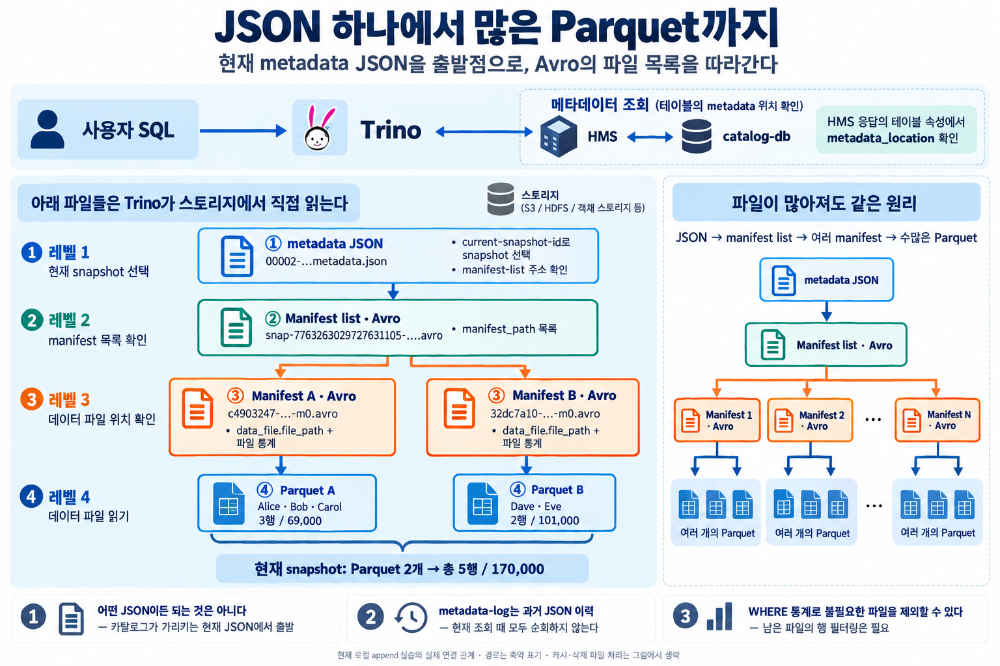

# JSON 하나에서 많은 Parquet까지



**현재 metadata JSON 하나를 출발점으로, 선택한 스냅샷에 속하는 많은 Parquet 파일을 찾을 수 있다.** JSON 하나에 모든 파일 경로나 데이터 행이 들어 있다는 뜻은 아니다. JSON → manifest list → 여러 manifest → 여러 데이터 파일로 참조가 이어진다.

## 실제 실습 파일에서 확인한 연결

```text
HMS 테이블 속성의 metadata_location
└─ 00002-90bf61b9-….metadata.json
   └─ current-snapshot-id: 7763263029727631105
      └─ manifest-list: snap-7763263029727631105-1-32dc7a10-….avro
         ├─ c4903247-…-m0.avro
         │  └─ 첫 배치 Parquet: Alice, Bob, Carol / 3행 / 69,000
         └─ 32dc7a10-…-m0.avro
            └─ 추가 배치 Parquet: Dave, Eve / 2행 / 101,000

현재 스냅샷 전체: Parquet 2개 / 5행 / 170,000
```

경로는 표시를 위해 축약했다. JSON과 Avro는 실제 로컬 파일을 읽어 확인했다. 원문·스키마·파일 통계·행을 직접 보는 코드는 [read_parquet.ipynb](../../analysis/read_parquet.ipynb)에 있다.

## 제공된 Gemini 설명 검토

큰 흐름은 맞지만 아래 표현은 보완해야 한다.

| 설명 | 검토 및 정확한 의미 |
|---|---|
| `type=hive`, `thrift://hms:9083` | 맞다. SeaTunnel Iceberg 커넥터의 Hive catalog가 HMS API를 사용한다. 이 프로젝트 실제 테이블 경로는 `/lake/warehouse/retail.db/orders`다 |
| HMS가 JSON 주소 딱 하나만 반환 | 핵심 정보가 JSON 포인터라는 뜻은 맞다. 실제 HMS API는 속성 등을 담은 테이블 정보를 반환한다. `metadata_location`은 그 속성 중 하나다 |
| JSON은 테이블당 무조건 최신 하나만 읽음 | 일반적인 한 테이블 조회의 논리적 시작점은 현재 metadata JSON이다. 캐시 때문에 매 쿼리마다 디스크에서 읽는 것은 아니며, 여러 테이블 조회 등도 있으므로 물리적 읽기 횟수를 무조건 1회로 단정하면 안 된다 |
| 어떤 JSON으로든 원하는 데이터를 조회 | 아니다. 해당 JSON이 설명하는 스냅샷과 그 참조 파일 범위만 접근할 수 있다. 과거 JSON은 이후 커밋 데이터를 모른다. 현재 JSON에 남아 있는 과거 스냅샷은 그 JSON에서 선택할 수 있지만 만료·정리된 이력을 영원히 조회할 수는 없다 |
| `metadata-log`의 `metadata-file`을 따라 Parquet 탐색 | 아니다. 이것은 과거 metadata JSON 이력이다. 일반적인 현재 데이터 탐색은 `snapshots`의 `manifest-list`를 따른다 |
| 파일이 많으면 JSON에 담을 수 없어서 Avro 사용 | 물리적으로 담을 수 없다는 뜻은 부정확하다. 메타데이터를 분리하고 manifest를 재사용하며 통계 기반 제외·병렬 처리를 지원하기 위한 구조다. 단순히 파일 확장자를 바꾸는 문제는 아니다 |
| manifest의 행 수는 “이번에 추가된 행 수” | `data_file.record_count`는 해당 파일의 전체 레코드 수다. 이번 실습의 신규 파일에서는 추가 행 수와 같지만 일반적으로 구분해야 한다 |
| WHERE나 LIMIT로 원하는 파일만 정확히 읽음 | WHERE에 맞지 않음이 통계로 입증되는 파일은 제외할 수 있다. 남은 후보 파일은 실제 행을 읽고 필터링해야 할 수 있다. LIMIT은 결과 행 수 제한이며, WHERE처럼 min/max로 파일을 판별하는 조건이 아니다. 분산 실행에서 정확히 필요한 행 수만 물리적으로 읽는다고 보장하지 않는다 |
| 데이터 파일 저장과 DB 등록이 한 번에 원자적으로 완료 | 잘못된 표현이다. 파일을 먼저 작성하고 마지막에 현재 metadata 포인터를 원자적으로 교체해 새 상태를 공개한다. 파일 저장과 PostgreSQL을 묶는 단일 트랜잭션이 아니다. 커밋 실패 시 참조되지 않는 파일이 남을 수 있다 |
| 파일 수가 수백만 개여도 정확하고 빠르게 읽음 | 많은 파일을 관리하도록 설계된 것은 맞지만 속도는 조건·통계·파일 크기·파티션·메타데이터 규모 등에 달려 있다. 계층을 따른다는 것만으로 상수 시간이나 빠른 성능을 보장하지 않는다 |

HMS는 SQL을 실행하지 않는다. Trino가 SQL을 받고 HMS에서 테이블 정보를 얻은 뒤 JSON·Avro·Parquet를 직접 읽는다. 그림은 현재 append 전용 실습이며 일반 Iceberg 테이블에서는 delete 파일 등의 처리도 필요하다.

## 공식 근거

- [Iceberg specification](https://iceberg.apache.org/spec/): 테이블 메타데이터, snapshot, manifest list, manifest 구조 및 메타데이터 포인터 교체에 의한 커밋.
- [Trino Iceberg connector](https://trino.io/docs/current/connector/iceberg.html): 메타데이터 기반 조회와 메타데이터 캐시 설정.
- [Trino predicate 처리 설명](https://trino.io/blog/2023/04/11/date-predicates.html): 파일 통계로 불필요한 파일을 제외하는 원리.
- [Hive 4.0.1 Thrift API 정의](https://github.com/apache/hive/blob/rel/release-4.0.1/standalone-metastore/metastore-common/src/main/thrift/hive_metastore.thrift): Table 구조체와 parameters, get_table API.

PNG는 내장 imagegen으로 생성했다. 생성 프롬프트는 같은 이미지 폴더의 `07-json-to-parquet.prompt.txt`에 보관한다.
