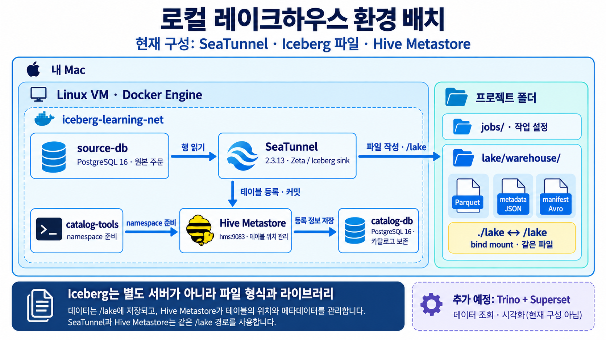
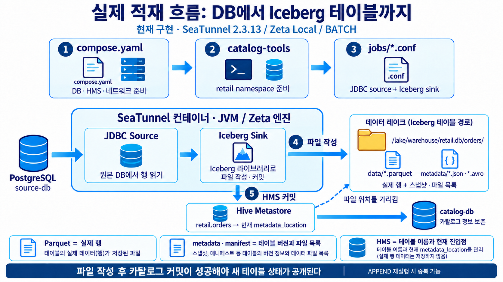
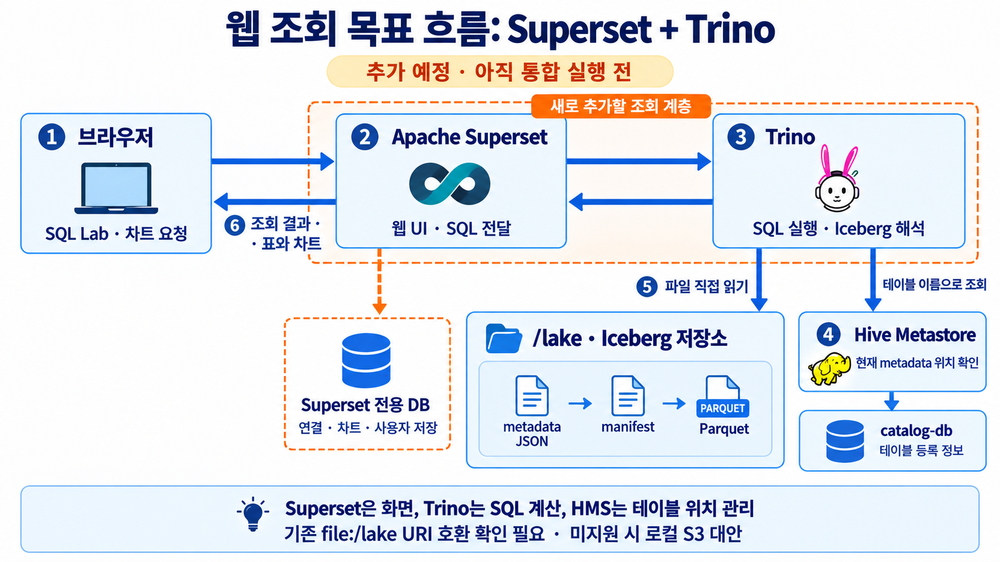
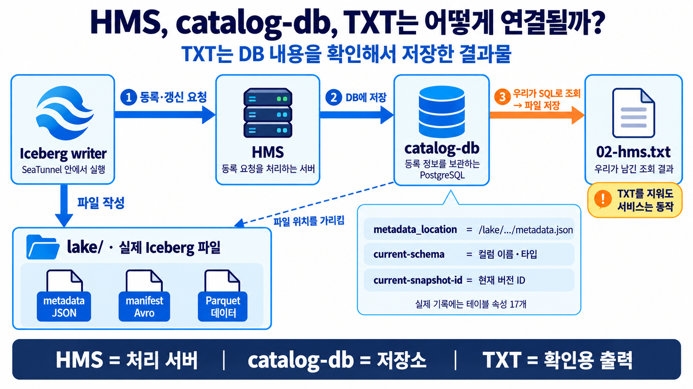
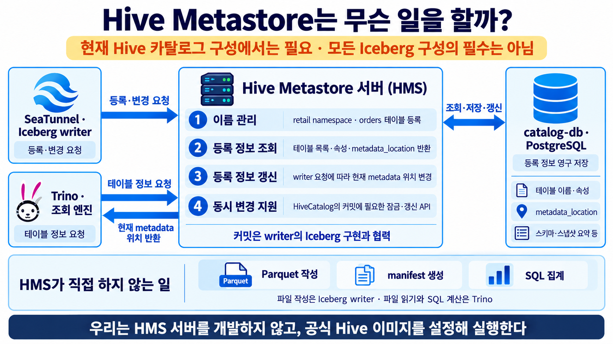

# 그림으로 이해하는 로컬 데이터 레이크하우스

작성일: 2026-10-06. SeaTunnel 실습 슬라이드 8·9페이지의 그림을 참고해 **현재 환경 → 적재 과정 → 웹 조회 목표** 순서로 정리했다.

**상태 갱신 (2026-10-06): Trino 483의 기존 Iceberg 조회까지 검증 완료했다. Superset은 추가할 목표 구조다. [Trino 실행 안내](../trino-local-query.md)를 참고한다. PNG의 “Trino 추가 예정” 표시는 제작 당시 상태다.** 그림은 저장소의 설정과 기존 구현을 설명하며, 이번 작업에서 서비스를 새로 실행하거나 적재하지 않았다.

## 1. 환경 세팅: 무엇을 어디에 띄우나?



Mac 안의 Linux VM에서 Docker 컨테이너들이 실행된다. 컨테이너는 프로그램을 실행하는 분리된 환경이고, `iceberg-learning-net`은 이 컨테이너들이 서비스 이름으로 통신하는 네트워크다.

| 준비할 것 | 현재 설정 | 역할 |
|---|---|---|
| 원본 데이터베이스 | `source-db`, PostgreSQL 16 | 이관할 주문 데이터 보관 |
| 적재 엔진 | SeaTunnel 2.3.13, Zeta local mode | 원본 행을 읽고 Iceberg 테이블에 기록 |
| 카탈로그 서비스 | `hms`, Hive Metastore 4.0.1 | 테이블 이름과 현재 메타데이터 위치 관리 |
| 카탈로그 DB | `catalog-db`, PostgreSQL 16 | HMS의 등록 정보 영속 보관 |
| 초기화 도구 | `catalog-tools` | `retail` namespace 준비 후 종료 |
| 실제 파일 저장소 | 호스트 `./lake` ↔ 컨테이너 `/lake` | Parquet와 Iceberg 메타데이터 보관 |

**bind mount**는 호스트의 폴더를 컨테이너 안의 경로에 연결하는 설정이다. 그림의 `./lake ↔ /lake`는 데이터를 두 벌 복사한다는 뜻이 아니라, 같은 파일을 서로 다른 경로 이름으로 보는 것이다. SeaTunnel과 HMS가 동일한 `/lake` 경로를 사용한다.

**namespace**는 테이블을 묶는 논리적인 이름 공간이다. 여기서는 `retail`이고 그 아래 `orders` 테이블을 둔다. `catalog-tools`는 namespace만 준비하며 실제 주문을 적재하지 않는다.

HMS와 두 PostgreSQL은 서비스로 실행한다. SeaTunnel은 적재 작업을 수행할 때, `catalog-tools`는 초기화할 때 실행하는 도구다. 그림에 함께 있다고 모두 계속 실행되는 것은 아니다. 현재 Compose는 DBeaver에서 catalog-db를 확인하도록 `127.0.0.1:15432:5432`만 공개한다.

확인할 파일: [compose.yaml](../../compose.yaml), [초기화 스크립트](../../scripts/up.sh), [namespace 준비 코드](../../scripts/prepare_catalog.py).

## 2. 실제 구현: 데이터가 Iceberg 테이블이 되는 과정



그림 위쪽 ①~③은 **환경 준비와 작업 설정 순서**다. `compose.yaml` 자체가 처리 엔진인 것은 아니며, `catalog-tools`가 job 파일을 생성한다는 뜻도 아니다.

1. **서비스를 준비한다.** `scripts/up.sh`가 원본 DB, 카탈로그 DB, HMS를 시작하고 초기화 도구를 실행한다.
2. **namespace를 만든다.** HMS에 `retail`을 준비한다. 아직 이 단계에서는 주문 행을 쓰지 않는다.
3. **작업 설정을 SeaTunnel에 전달한다.** `.conf`에 원본 JDBC 쿼리, sink 종류, HMS 주소, warehouse 경로를 적는다. `seatunnel-entry.sh`가 Zeta local mode로 실행한다.
4. **SeaTunnel이 행과 메타데이터를 파일로 쓴다.** JDBC source가 원본을 읽고, 같은 SeaTunnel JVM에서 실행되는 Iceberg sink가 파일을 작성한다. 현재 job에는 별도 transform 블록이 없다.
5. **HMS에 새 테이블 상태를 커밋한다.** 파일 작성만으로 끝나지 않는다. 카탈로그가 새 metadata 위치를 가리키도록 커밋해야 새 상태가 공개된다.

**커밋**은 새로 만든 파일 집합을 테이블의 유효한 상태로 확정하는 과정이다. **스냅샷**은 그 시점의 테이블이 어떤 파일들을 포함하는지 나타내는 기록이다. **manifest**는 데이터 파일 경로와 통계 등을 담은 목록이다.

```text
호스트: lake/warehouse/retail.db/orders/
컨테이너: /lake/warehouse/retail.db/orders/

├── data/*.parquet        실제 주문 행
└── metadata/
    ├── *.metadata.json  스키마·스냅샷 등 테이블 정보
    ├── snap-*.avro      스냅샷이 참조하는 manifest 목록
    └── *-m0.avro        데이터 파일 목록·통계 (이름은 구현에 따라 다름)
```

그림의 점선 `HMS → 저장소`는 **위치 참조**를 뜻한다. HMS가 주문 행을 받아 Parquet으로 변환하거나, 조회 결과를 전달하는 흐름이 아니다. HMS의 PostgreSQL에는 테이블 등록 정보가, `lake/`에는 실제 행과 Iceberg 메타데이터 파일이 저장된다.

현재 job의 핵심 설정은 다음과 같다.

```hocon
Iceberg {
  catalog_name = "local_hive"
  iceberg.catalog.config = {
    type = "hive"
    uri = "thrift://hms:9083"
    warehouse = "file:///lake/warehouse"
  }
  namespace = "retail"
  table = "orders"
  data_save_mode = "APPEND_DATA"
}
```

이는 설명용 발췌다. 전체 설정은 [첫 배치 job](../../jobs/01_orders_to_iceberg.conf), [두 번째 배치 job](../../jobs/02_orders_to_iceberg.conf)을 참고한다. 기존 배치 두 개는 원본 5건을 3건과 2건으로 나눠 읽는다. `APPEND_DATA`를 반복하면 중복될 수 있으므로 그림을 따라 기존 job을 재실행하지 않는다. 현재는 기존 중복 검사·배치 래퍼가 제거된 상태다.

## 3. 웹 조회 목표: Superset과 Trino를 어디에 붙이나?



주황색 점선은 그림 제작 당시의 추가 예정 구성이다. 이후 Trino는 현재 `file:/lake/...` URI로 읽기 검증에 성공했고, Superset과 전용 DB도 2026-10-07 구현했다 ([접속 안내](../superset-local-ui.md)).

1. 브라우저에서 Superset의 SQL Lab 또는 차트를 연다.
2. Superset이 SQL을 Trino에 보낸다. Superset은 사용자가 보는 웹 화면을 담당한다.
3. Trino가 SQL을 분석하고 Iceberg 테이블을 읽을 계획을 세운다.
4. Trino가 HMS에서 `retail.orders`의 현재 metadata 위치를 얻는다.
5. Trino가 저장소의 metadata JSON → manifest list → manifest → Parquet을 읽는다. 그림에서는 가운데 두 목록 계층을 `manifest`로 묶었다.
6. 계산 결과가 Trino → Superset → 브라우저로 돌아와 표와 차트로 표시된다.

**조회 엔진은 Trino다.** Superset이 HMS나 Parquet에 직접 SQL을 보내는 구조가 아니다. 조회 결과를 만들기 위해 실제 파일에 접근하는 주체도 Trino다.

Superset 전용 DB는 연결 설정·사용자·차트·대시보드를 보존한다. HMS의 `catalog-db`와는 별도 역할이며, Iceberg 주문 데이터를 여기에 복사해서 조회하는 설계가 아니다.

추가 구현 순서는 다음과 같다.

| 순서 | 추가·설정할 것 | 성공 확인 |
|---|---|---|
| 1 | Trino + Iceberg 커넥터 + HMS 연결 | `retail.orders` 목록 확인 |
| 2 | Trino의 저장소 접근 | 목록뿐 아니라 `SELECT`로 실제 행 읽기 |
| 3 | Superset + 전용 DB + Trino Python 드라이버 | Superset에서 Trino 연결 테스트 |
| 4 | SQL Lab → Dataset → 차트 | 5건·합계 170000 및 상태별 차트 확인 |

위 숫자는 Trino에서 검증한 결과다. Superset 차트 API에서도 같은 결과를 확인했다. 로컬 파일 URI가 호환되지 않으면 로컬 S3 호환 저장소에 새 테이블을 만들어 연결하는 대안을 사용한다. 두 선택지는 [저장소 구성 문서](../local-lakehouse-build-options.md)에 설명되어 있다.

## 4. 그림과 실제 파일을 함께 읽기

| 이해하고 싶은 부분 | 확인할 파일 |
|---|---|
| 컨테이너·네트워크·볼륨 | [compose.yaml](../../compose.yaml) |
| 초기 서비스와 namespace 준비 | [up.sh](../../scripts/up.sh), [prepare_catalog.py](../../scripts/prepare_catalog.py) |
| JVM/Zeta 실행 진입점 | [seatunnel-entry.sh](../../scripts/seatunnel-entry.sh) |
| 원본 쿼리와 Iceberg sink 설정 | [01_orders_to_iceberg.conf](../../jobs/01_orders_to_iceberg.conf) |
| 전체 구축 순서·SQL·완료 기준 | [구축 안내서](../local-lakehouse-superset.md) |

PNG는 `docs/assets/lakehouse-flow/`에 저장했다. 내장 ImageGen 도구로 생성했으며, 시각 스타일은 `Onboarding/seatunnel/image/`의 환경 배치 및 실행 흐름 PNG를 참고했다. 재생성에 사용한 [프롬프트 기록](../assets/lakehouse-flow/generation-prompts.md)도 함께 보관한다.

## 5. HMS와 catalog-db, 02-hms.txt의 관계



**HMS는 처리 서버, catalog-db는 등록 정보 저장소, TXT는 확인용 출력물이다.**

- Writer는 `lake/`에 Iceberg 파일을 쓰고 HMS에 테이블 정보를 등록·갱신한다.
- HMS가 `catalog-db`에 저장한 테이블 속성을 우리가 SQL로 조회해 `02-hms.txt`에 남겼다. TXT가 등록의 입력 파일인 것은 아니다.
- 점선은 DB에 저장된 `metadata_location`이 실제 파일 위치를 가리킨다는 뜻이다. PostgreSQL이 직접 파일을 읽거나 HMS가 폴더를 수집한다는 의미가 아니다.

그림의 경로는 축약 표기이고, `current-snapshot-id`는 현재 스냅샷을 식별하는 ID다. 17개는 이번 테이블에서 조회된 속성 개수이며 고정된 전체 메타데이터 개수가 아니다. 그림의 ①~③은 등록과 확인의 관계를 설명하며, 파일 작성보다 먼저 커밋한다는 뜻은 아니다.

## 6. Hive Metastore의 상세 역할



**현재 선택한 Hive 카탈로그 구성에서는 HMS가 필요하다. 모든 Iceberg 구성에서 반드시 필요한 것은 아니다.** JDBC Catalog 등 다른 카탈로그를 선택할 수도 있지만, 현재 설정에서 HMS만 제거하면 같은 방식으로 동작하지 않는다.

HMS는 namespace·테이블 등록, 등록 정보 조회·갱신, HiveCatalog 커밋에 필요한 잠금 등의 API를 제공한다. 데이터 파일과 Iceberg 메타데이터 파일의 작성은 writer가 수행하고, 커밋은 Iceberg 구현과 HMS가 협력한다. PostgreSQL은 HMS의 등록 정보를 보존한다.

그림의 Trino는 현재 연결·검증을 마친 조회 클라이언트다. HMS 서버 기능은 Apache Hive가 제공하며, 우리는 공식 이미지의 DB 연결·드라이버·네트워크·영속 저장 설정을 구성한다.
