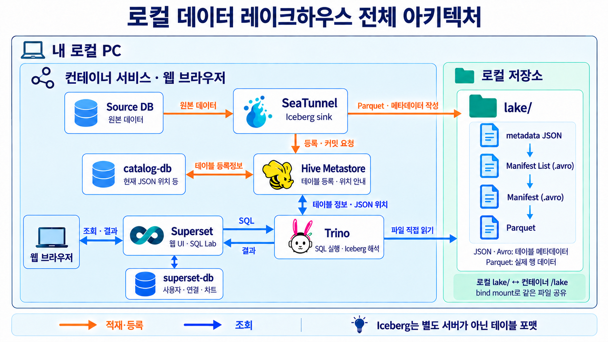

# 로컬 레이크하우스 전체 아키텍처



발표 02장 첫머리에 전체 목표를 먼저 보여준 뒤 기존 저장·조회 상세 슬라이드로 이어가기 위한 이미지. 발표 HTML·기획 MD는 수정하지 않았다.

주황색은 원본 데이터 적재·파일 작성·HMS 커밋, 파란색은 SQL 조회와 파일 읽기다. catalog-db는 HMS 등록정보를 저장하며 데이터 행은 lake/에 있다. Trino는 HMS에서 테이블 정보를 얻고 파일을 직접 읽는다. 웹 브라우저는 호스트에서 사용하며 Docker 서비스가 아니다. 별도 초기화 서비스는 전체 개요에서 생략했다.

원본 03 이미지의 '추가 예정'은 반영하지 않았다. 현재 구현된 통합 구성의 개요이며 이번 작업에서 서비스를 재실행하지 않았다. PNG를 발표에 삽입해 사용하면 된다.

## 생성 기록

내장 image_gen 사용. 참조: 03-superset-query-flow.png, 09-basic-container-environment-crop-v2.png.

### 생성 프롬프트

```text
Use case: infographic-diagram. Generate one new polished landscape 16:9 Korean presentation architecture illustration. The two referenced PNGs are STYLE AND COMPONENT REFERENCES ONLY, do not collage or preserve outdated status text. White background, light pale blue service panels, navy large typography, straight rectangular boxes, simple readable icons, teal filesystem. Minimal text, generously spaced arrows, slide-ready. Title "로컬 데이터 레이크하우스 전체 아키텍처". No ports, URLs, configuration filenames, numbered slide headings, planned status, or implementation details. All components implemented.

Layout exact to avoid crossing arrows: overall rounded outer boundary "내 로컬 PC". Within it a large left/center region "Docker 실행 환경" (about 72% width), a separate tall right region "로컬 저장소". Within Docker region, arrange a grid with TOP row "Source DB" at left and "SeaTunnel" at center-right with subtitle "Iceberg sink". Orange arrow Source DB → SeaTunnel labelled "원본 데이터". Orange arrow SeaTunnel → right storage region labelled "Parquet · 메타데이터 작성". MIDDLE row "catalog-db" at left, "Hive Metastore" at center-right. SeaTunnel downward orange arrow → Hive Metastore labelled "등록 · 커밋 요청". Hive Metastore ↔ catalog-db horizontal arrow labelled "테이블 등록정보". catalog-db subtitle "현재 JSON 위치 등". Hive Metastore subtitle "테이블 등록 · 위치 안내". BOTTOM row "Superset" at left, "Trino" at center-right. Superset subtitle "웹 UI · SQL Lab", Trino subtitle "SQL 실행 · Iceberg 해석". Superset→Trino blue arrow labelled "SQL", return arrow Trino→Superset labelled "결과". Trino upward blue bidirectional arrow ↔ Hive Metastore labelled "테이블 정보 · JSON 위치". Trino → right storage region blue arrow labelled "파일 직접 읽기". This arrow denotes read request, keep the exact label. Far bottom below Superset smaller cylinder "superset-db" subtitle "사용자 · 연결 · 차트" with connection only to Superset. A small "웹 브라우저" laptop at far left outside Docker boundary but inside local PC, bidirectional connection to Superset labelled "조회 · 결과". Fit browser in left margin and ensure Source DB remains inside Docker. No browser→Trino arrow.

Right storage region: big folder "lake/" and stacked file icons labels "metadata JSON", "Manifest List (.avro)", "Manifest (.avro)", "Parquet". Thin arrows connecting these downward, indicating reference traversal. Under file chain text "JSON·Avro: 테이블 메타데이터" and "Parquet: 실제 행 데이터". At bottom of storage region small text "로컬 lake/ ↔ 컨테이너 /lake" and "bind mount로 같은 파일 공유". Avoid drawing HMS→lake arrow; focus on actual file readers/writers.
Bottom legend outside local PC boundary: orange "적재·등록" blue "조회" and footer "Iceberg는 별도 서버가 아닌 테이블 포맷". Each DB is visibly separate. Keep everything legible with short Korean labels and no overlaps. Source data goes to lake via SeaTunnel, NEVER via HMS or catalog-db; Trino reads lake directly and asks HMS only for table metadata. Superset does not read lake itself. This is the overall goal architecture before teaching individual setup steps.
```

### 최종 수정 프롬프트

패널 제목 Docker 실행 환경을 컨테이너 서비스 · 웹 브라우저로 변경하고 Docker 고래 아이콘을 중립적인 네트워크 아이콘으로 교체. 브라우저가 컨테이너라는 오해를 방지하며 나머지 그림 보존.


## 로고 수정본

사용자 제공 Trino·Hive 이미지를 참고한 내장 image_gen 수정본: `../assets/lakehouse-flow/11-local-lakehouse-overview-v2.png`. 기존 PNG와 발표 HTML은 보존했다.

수정 프롬프트 요지: 기존 전체 구성 유지, Trino를 민트색 얼굴과 회색 우주복 헬멧·분홍 귀의 참조 마스코트로 교체, Hive를 큰 왼쪽 날개와 검정/노랑 줄무늬의 참조 마스코트로 교체. 중복 워드마크 생략.

## 발표용 v3

최신 사용본: `../assets/lakehouse-flow/11-local-lakehouse-overview-v3.png`. Docker 고래 아이콘 및 Docker 컨테이너 제목 적용, 브라우저를 PC 안/컨테이너 밖에 배치, 상단 전체 제목 제거. 범례·파일 참조 체인·bind mount 안내 유지. 내장 image_gen 사용. 발표 HTML은 변경하지 않았다.
