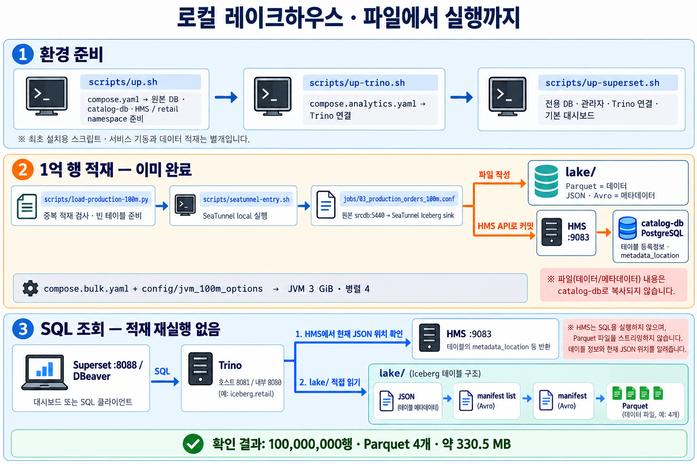

# config · jobs · scripts는 언제 쓰나요?

**config는 설정, jobs는 적재 작업의 정의, scripts는 실행을 편하게 묶은 도구다.**
Compose 파일은 어떤 컨테이너를 띄우고 이 파일들을 어디에 연결할지 정한다.



## 처음 검토할 때 읽는 순서

1. **이 문서**에서 실행 흐름과 각 파일의 역할을 본다.
2. [compose.yaml](../../compose.yaml)에서 DB·HMS·SeaTunnel의 연결과 `/lake` 마운트를 본다.
3. [1억 행 job](../../jobs/03_production_orders_100m.conf)의 `source → transform → sink`를 읽는다.
4. [compose.analytics.yaml](../../compose.analytics.yaml)과 [Trino Iceberg 설정](../../config/trino/catalog/iceberg.properties)에서 조회 연결을 본다.
5. [1억 행 실행·메모리 문제·검증 기록](../production-orders-100m.md)을 본다. 실제 검증 결과는 [verification.json](../../evidence/production-100m/verification.json)에 있다.

아래는 **이미 실행한 구성을 설명하는 지도**다. 적재를 다시 실행하는 절차가 아니다. 그림의 단계는 역할을 구분한 것이며 설치와 적재의 유일한 실행 순서를 뜻하지 않는다.

## 1. 환경 준비 — 누가 서비스를 만들었나?

`scripts/up.sh`가 `compose.yaml`을 사용해 샘플 원본 DB, catalog-db, HMS를 띄운다. PostgreSQL 연결용 `vendor/postgresql.jar`도 준비한다. 이어 `catalog-tools`에서 `prepare_catalog.py`를 실행해 HMS에 `retail` namespace를 만든다. namespace는 `retail.orders`의 `retail`처럼 테이블을 묶는 이름 공간이다.

HMS의 DB 주소는 `compose.yaml`의 `hms.environment.SERVICE_OPTS`에 있는 `jdbc:postgresql://catalog-db:5432/metastore`다. HMS가 요청을 처리하고 그 등록정보를 PostgreSQL에 저장한다. DB의 실제 데이터는 Docker의 `catalog-db` 볼륨에 남는다.

**1억 행 원본은 위 샘플 source-db와 다르다.** 기존 SeaTunnel 실습의 `localhost:5440/srcdb`에 있는 `production_orders_100m`이며, 컨테이너에서는 `host.docker.internal:5440`으로 접속한다.

`scripts/up-trino.sh`는 기본 Compose와 `compose.analytics.yaml`을 함께 사용해 Trino를 켠다. `config/trino/catalog/iceberg.properties`에서 HMS 주소와 로컬 파일 접근을 설정하고, `./lake:/lake:ro`로 같은 파일을 읽는다.

`scripts/up-superset.sh`는 다음 작업을 묶는다.

```text
prepare_superset_env.py → .env.superset 준비
Superset 이미지 빌드 → Trino·PostgreSQL 연결 드라이버 설치
superset-init.sh → Superset DB 초기화 + 관리자·권한 준비
Superset 기동 → bootstrap_superset.py로 연결·기존 orders 대시보드 등록
```

Superset 전용 DB는 사용자·연결·차트·대시보드 등의 설정 저장소다. catalog-db나 원본 DB와 별개다. 내부 연결은 `trino:8080`, Mac의 DBeaver 연결은 `localhost:8081`이다.

## 2. 1억 행 적재 — 어느 파일에서 시작하나?

시작점은 [scripts/load-production-100m.py](../../scripts/load-production-100m.py)다. **현재 성공한 적재 기록과 테이블이 있으므로 재실행할 필요가 없다.**

```text
load-production-100m.py
  ├─ 대상 테이블·저장 경로·load-state.json 검사로 중복 실행 차단
  ├─ prepare-production-catalog.sh
  │    └─ PrepareProductionCatalog.java: HMS API로 빈 append 테이블 준비
  └─ Compose의 seatunnel 작업 컨테이너 실행
       └─ seatunnel-entry.sh → seatunnel.sh -m local
            └─ jobs/03_production_orders_100m.conf 읽기
                 ├─ source: JDBC로 srcdb의 원본 읽기
                 ├─ transform: 값·최종 컬럼명 유지, 원본 PK 메타데이터 제거
                 └─ sink: Iceberg 라이브러리로 파일 작성 + HMS 커밋
```

`compose.bulk.yaml`은 작업 컨테이너에 원본 접속 환경변수와 4GiB 메모리 한도를 제공한다. `config/jvm_100m_options`는 JVM 힙을 3GiB로 설정한다. 병렬도 4와 fetch size 5000은 job에서 설정한다. PK 메타데이터를 제거한 이유는 이번 append 적재에서 키별 위치를 누적하는 writer의 메모리 문제를 피하기 위해서다. 데이터의 `order_id` 값은 유지한다.

Iceberg sink가 데이터를 쓰는 곳과 등록 요청을 보내는 곳은 다음처럼 나뉜다.

| 저장 대상 | 처리 주체와 내용 |
|---|---|
| `lake/warehouse/retail.db/production_orders_100m_append/` | SeaTunnel 내부 Iceberg writer가 Parquet, manifest·manifest list Avro, metadata JSON 작성 |
| HMS → catalog-db | Iceberg HiveCatalog가 `thrift://hms:9083`으로 커밋 요청. HMS가 현재 JSON 위치인 `metadata_location`과 테이블 속성 등을 반영 |

**파일을 먼저 쓴 뒤 새 상태를 카탈로그에 공개한다.** 커밋은 테이블의 새 상태를 확정하는 단계다. 파일 작성과 PostgreSQL 저장을 하나의 DB 트랜잭션으로 묶는 것은 아니다. 실패 시 미참조 파일이 남을 수 있다. HMS가 디렉터리를 훑어서 파일을 자동 등록하는 것도 아니다.

그림의 “파일 내용은 복사되지 않는다”는 파일 전체를 catalog-db에 넣지 않는다는 뜻이다. 스키마·현재 snapshot ID·summary 같은 일부 정보는 HMS 속성에도 중복 저장될 수 있다.

## 3. 조회 — Superset에서 SQL을 누르면?

1. Superset이 Trino에 SQL을 보낸다.
2. Trino의 Iceberg 커넥터가 HMS에서 테이블 정보와 현재 `metadata_location`을 얻는다. HMS는 자신의 catalog-db를 사용한다.
3. Trino가 `/lake`에서 JSON을 읽고 선택한 snapshot → manifest list → manifest를 따라 필요한 데이터 파일을 찾는다.
4. Trino가 Parquet을 읽어 SQL을 처리하고 Superset에 결과를 돌려준다.

이는 논리적인 탐색 흐름이며 캐시·조건에 따른 파일 건너뛰기 등으로 매번 모든 파일을 새로 읽지는 않는다. Superset 조회 때 SeaTunnel은 실행되지 않는다.

## 4. 완료 여부는 어디에서 확인하나?

| 기록 | 의미 |
|---|---|
| `evidence/production-100m/load-state.json` | SeaTunnel 실행 성공 여부 |
| `evidence/production-100m/seatunnel.log` | 실제 적재 실행 로그 |
| `evidence/production-100m/source-summary.csv` | 원본 집계 기준값 |
| `evidence/production-100m/trino-summary.csv` | Iceberg를 Trino로 조회한 집계 |
| `evidence/production-100m/verification.json` | 집계 비교 PASS, 1억 행, Parquet 4개·330,496,199 bytes |

위 결과는 2026-10-08 검증 기록이며 Superset SQL Lab 조회는 사용자가 확인했다. 이번 2026-10-12 문서 정리에서는 적재·검증 쿼리를 재실행하지 않았다.

## 지금 내가 사용할 것

이미 주문 5건 및 별도 테이블의 1억 행 적재와 Trino/Superset 연결을 마쳤다. 평소에는 Superset의 **SQL → SQL Lab**이나 DBeaver에서 조회하면 된다. 쿼리를 실행할 때마다 초기화·적재 스크립트를 실행하지 않는다.

Mac 터미널에서 `Onboarding/iceberg` 폴더를 기준으로:

```sh
# 초기 설정을 마친 서비스를 다시 켜기
docker compose -f compose.yaml -f compose.analytics.yaml up -d --wait superset

# 웹 로그인 정보 확인
python3 scripts/show-superset-login.py

# 웹 대신 터미널에서 조회하고 싶을 때
bash scripts/trino.sh --execute 'SELECT * FROM iceberg.retail.orders ORDER BY order_id'
```

## scripts 전체 지도

아래의 “내부 호출” 파일은 상위 스크립트나 Compose가 실행한다. 하나씩 수동 실행할 필요가 없다.

| 파일 | 사용하는 시점 | 실행 주체 / 역할 |
|---|---|---|
| `up.sh` | 최초 기초 환경 준비 | Mac에서 직접 실행. JDBC JAR 준비 → catalog-tools 이미지 빌드 → 원본 DB·catalog-db·HMS 기동 → namespace 준비 |
| `prepare_catalog.py` | `up.sh` 내부 | catalog-tools 컨테이너에서 HMS에 `retail` namespace를 준비한다. 주문 테이블과 행은 만들지 않는다 |
| `seatunnel-entry.sh` | 적재 job 실행 시 | SeaTunnel 컨테이너 entrypoint. 충돌하는 JDBC 드라이버를 비활성화하고 전달된 job 설정으로 SeaTunnel을 실행 |
| `up-trino.sh` | Trino 조회 환경 기동 | Mac에서 직접 실행. 기존 catalog-db·HMS와 Trino 기동 |
| `trino.sh` | 터미널 SQL 조회 | Mac에서 직접 실행. 실행 중인 Trino 컨테이너의 CLI에 SQL 전달 |
| `verify_trino.py` | 결과를 다시 검증할 때 | Mac에서 직접 실행. 현재 실습의 5건·합계·스냅샷 등 확인 후 `evidence/trino/` 기록. 데이터를 추가하면 기존 기대값과 달라질 수 있음 |
| `catalog.sql` | HMS 내부 등록정보를 보고 싶을 때 | catalog-db에 접속한 SQL 도구에서 실행하는 SELECT. `DBS`, `TBLS`, `TABLE_PARAMS`를 연결해 출력. 데이터 적재나 갱신용 SQL이 아님 |
| `up-superset.sh` | Superset 전체 설치·초기 설정 | Mac에서 직접 실행. 아래 내부 도구를 묶어 실행하고 Trino와 웹 서버를 기동 |
| `prepare_superset_env.py` | `up-superset.sh` 내부 | Mac에서 `.env.superset` 생성. 이미 있으면 보존 |
| `superset-init.sh` | `up-superset.sh` 내부 | superset-init 컨테이너에서 DB 마이그레이션 → 관리자 준비 → 권한 초기화 |
| `superset_admin.py` | `superset-init.sh` 내부 | 관리자 계정이 없을 때 생성. 기존 계정은 보존 |
| `bootstrap_superset.py` | 웹 서버 기동 후 | Superset 컨테이너에서 REST API로 Trino 연결·Dataset·차트·대시보드 등록. 기존 항목은 재사용하고 실제 조회 결과를 `evidence/superset/`에 저장 |
| `show-superset-login.py` | 로그인 정보가 필요할 때 | Mac에서 직접 실행. `.env.superset`에서 웹 로그인 정보만 표시 |
| `load-production-100m.py` | 1억 행 일회 적재 | Mac에서 실행하는 중복 방지 래퍼. 현재 적재 완료 |
| `prepare-production-catalog.sh` | 위 래퍼 내부 | SeaTunnel 컨테이너에서 Java 준비 코드를 컴파일·실행 |
| `PrepareProductionCatalog.java` | 테이블 준비 | Java Iceberg API로 식별자 없는 빈 append 테이블 준비. 현재 테이블 조회에는 불필요 |
| `verify-production-100m.py` | 1억 행 결과 검증 | 원본 기록과 Trino 집계를 비교하고 evidence 저장 |
| `register-production-superset.py` | 선택 기능 | Superset 컨테이너에서 1억 행 Dataset·저장 SQL 등록 및 조회. 평소 SQL Lab 조회에 필수 아님. 실행 결과는 호스트 `evidence/superset/production-100m/`에 저장되며 현재 이 결과 기록은 없음 |

## config는 누가 읽나요?

| 파일 | 읽는 시점 / 역할 |
|---|---|
| `source.sql` | 원본 PostgreSQL의 데이터 디렉터리가 비어 있을 때 최초 초기화에 사용. 재시작마다 실행되는 SQL이 아님 |
| `Dockerfile.catalog` | catalog-tools 이미지 빌드 시 Python과 PyIceberg 준비 |
| `jvm_client_options` | SeaTunnel 실행 시 JVM 메모리 등 설정 |
| `jvm_100m_options` | `compose.bulk.yaml`이 기본 JVM 파일 대신 마운트하는 1억 행용 3GiB 힙 설정 |
| `trino/catalog/iceberg.properties` | Trino 시작 시 Iceberg 커넥터, HMS 주소, 로컬 파일 접근, 읽기 전용 정책 설정 |
| `trino/config.properties` | Trino 서버·쿼리 메모리 설정 |
| `trino/node.properties` | Trino 노드 정보·데이터 디렉터리 설정 |
| `trino/jvm.config` | Trino Java 프로세스 메모리 등 설정 |
| `trino/log.properties` | Trino 로그 수준 설정 |
| `Dockerfile.superset` | Superset 이미지 빌드 시 Trino·PostgreSQL 드라이버 설치 |
| `superset/superset_config.py` | Superset 시작·초기화 시 전용 DB 주소, 암호화 키, 캐시·동기 조회 설정 |

HMS → catalog-db 연결 설정은 `config/`의 별도 파일이 아니라 **`compose.yaml`의 hms → SERVICE_OPTS**에 있다. Dockerfile 변경은 이미지 재빌드, 실행 설정 변경은 해당 서비스 재기동이 필요할 수 있다.

## jobs는 언제 읽나요?

SeaTunnel을 실행할 때 전달한 `.conf`를 읽는다. source에는 원본 DB와 추출 SQL, sink에는 Iceberg 테이블과 HMS 주소, 저장 위치, APPEND 방식이 들어 있다.

- `01_orders_to_iceberg.conf`: `batch_id = 1`, 최초 3건 적재에 사용했다.
- `02_orders_to_iceberg.conf`: `batch_id = 2`, 추가 2건 적재에 사용했다.
- `03_production_orders_100m.conf`: 별도 srcdb에서 1억 행 적재에 사용했다. 중복 방지 래퍼와 함께 사용하는 작업이다.

**현재 두 배치는 이미 적재되어 있다.** 서비스 기동과 job 실행은 별개다. 기존 job을 다시 실행하면 같은 주문이 추가될 수 있으므로 그림을 따라 적재를 반복하지 않는다.

그림은 현재 파일 내용과 호출 관계를 설명한다. 이전 파일 지도 그림은 [06-project-files.png](../assets/lakehouse-flow/06-project-files.png)에 유지한다. 새 그림은 내장 imagegen으로 생성했고 생성 지시는 [이 문서의 그림 생성 기록](#그림-생성-기록)에 요약한다.

## 그림 생성 기록

2026-10-12, 내장 imagegen 사용. 생성 지시: 한국어 엔지니어 온보딩 인포그래픽으로 ① up.sh·up-trino.sh·up-superset.sh 환경 준비 ② load-production-100m.py → seatunnel-entry.sh → job → Iceberg 파일 작성과 HMS/catalog-db 등록 ③ Superset/DBeaver → Trino → HMS 위치 확인 및 JSON → Avro → Parquet 직접 읽기를 세 가로 영역에 표현. 흰 배경, 남색 글자, 쓰기 주황·읽기 파랑, 1억 행·4파일·330.5MB 결과 표시. 검토 후 중복 검사·빈 테이블 준비 설명을 load-production-100m.py 아래로 이동하고 Trino 호스트 8081/내부 8080을 명시하도록 수정했다.
