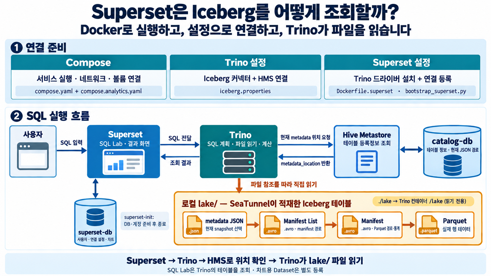

# Trino·Superset·Iceberg 연결 그림



Compose로 서비스를 실행한 뒤 Trino의 `iceberg.properties`로 Iceberg 커넥터와 HMS 연결을 설정한다. Superset 이미지는 Trino 드라이버를 포함하며, `scripts/bootstrap_superset.py`가 Trino 연결과 orders Dataset을 등록한다.

조회 시 Superset은 Trino에 SQL을 전달한다. Trino는 HMS에서 테이블 정보와 현재 metadata 위치를 얻고, lake의 JSON → manifest list → manifest → Parquet 참조를 따라 파일을 읽는다. catalog-db는 HMS 등록정보를, superset-db는 Superset 사용자·연결·차트 설정을 저장한다.

기존 환경 시작: 프로젝트 루트에서 `bash scripts/up-superset.sh`. 웹 주소는 http://localhost:8088 이다. 이번 작업은 기존 설정을 확인해 그림을 만든 것으로, 서비스 기동·적재·쿼리를 새로 실행하지 않았다. 추가 구현 작업은 없다.

## 생성 기록

내장 image_gen 사용. 최종 프롬프트:

```text
Create a polished Korean educational infographic PNG, landscape 16:9 high resolution, crisp large Korean typography, white background, navy headings, teal and blue rectangular service cards, amber file cards. Audience beginner engineers. Title "Superset은 Iceberg를 어떻게 조회할까?" Subtitle "Docker로 실행하고, 설정으로 연결하고, Trino가 파일을 읽습니다". One coherent diagram with a compact setup strip across top and large runtime diagram underneath. No IP addresses or port numbers. No decorative logos. Generous whitespace, short labels, clear arrow directions.
TOP strip heading "① 연결 준비" with three equal cards:
"Compose" / "서비스 실행 · 네트워크 · 볼륨 연결" / "compose.yaml + compose.analytics.yaml"
"Trino 설정" / "Iceberg 커넥터 + HMS 연결" / "iceberg.properties"
"Superset 설정" / "Trino 드라이버 설치 + 연결 등록" / "Dockerfile.superset · bootstrap_superset.py"
MAIN heading "② SQL 실행 흐름". Left-to-right three primary boxes: "사용자" small browser icon; "Superset" subtitle "SQL Lab · 결과 화면"; "Trino" subtitle "SQL 계획 · 파일 읽기 · 계산". Solid arrows User→Superset label "SQL 입력", Superset→Trino label "SQL 전달". A clearly separate thin return arrow Trino→Superset labelled "조회 결과". To the right of Trino place "Hive Metastore" subtitle "테이블 등록정보 조회", connected from Trino with arrow "현재 metadata 위치 요청", reverse arrow "metadata_location 반환". To right of Hive Metastore place cylinder "catalog-db" subtitle "테이블 정보 · 현재 JSON 경로", bidirectional link HMS↔catalog-db. NO Trino→catalog-db direct connection.
Below Superset, a small cylinder "superset-db" subtitle "사용자 · 연결 설정 · 차트" linked ONLY to Superset. Small adjacent note "superset-init: DB·계정 준비 후 종료".
Below Trino and HMS, large amber bordered storage region labelled "로컬 lake/ — SeaTunnel이 적재한 Iceberg 테이블". At top edge label "./lake → Trino 컨테이너 /lake (읽기 전용)". Inside clear horizontal file chain:
"metadata JSON" / "현재 snapshot 선택" → "Manifest List" / ".avro · manifest 경로" → "Manifest" / ".avro · Parquet 경로·통계" → "Parquet" / "실제 행 데이터".
Draw direct downward arrow from Trino into storage region labelled "파일 참조를 따라 직접 읽기". Make clear all JSON/Avro/Parquet reading is by Trino, NOT HMS or Superset. Storage is filesystem, not an Iceberg server/container. Add small bottom statement "Superset → Trino → HMS로 위치 확인 → Trino가 lake/ 파일 읽기". Footer "SQL Lab은 Trino의 테이블을 조회 · 차트용 Dataset은 별도 등록".
Ensure text is correctly spelled, labels non-overlapping, no arrows passing through text. Diagram should explain configuration as well as query flow, not imply merely starting Docker auto connects services. Use exact terms as given. Do not add SeaTunnel container, source DB, worker, Redis, unrequested services. Output a presentation-quality single PNG.
```
