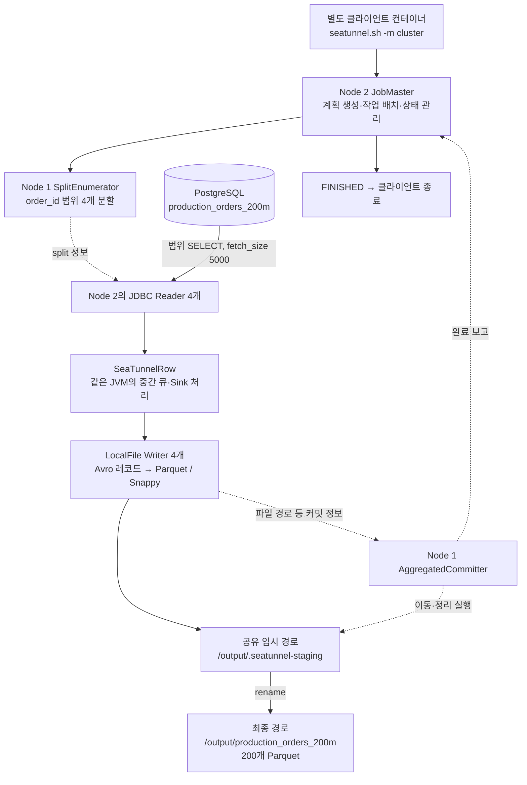

# SeaTunnel 2억 행 배치 실행 해설

2026-09-14 기준. 잡을 재실행하지 않고 현재 설정, Parquet 메타데이터, 이전 대화에서 직접 확인한 로그 결과, Apache SeaTunnel 2.3.13 태그 소스를 대조했다.

## 근거의 범위

- 현재 파일: `jobs/12_postgres_200m_to_parquet_cluster.conf`, `scripts/start-cluster.sh`, `scripts/run-cluster-job.sh`, `cluster/*.yaml`, `cluster/jvm_options`.
- 현재 출력: 200개 파일, 각 1,000,000행, 총 200,000,000행. 잡 ID `1150670253030637570`. 파일 합계 1,558,402,716바이트(약 1.56GB/1.45GiB).
- 현재 DB 크기 메타데이터: table_size 약 14GB, indexes_size 4284MB, total_size 약 18GB. 인덱스까지 Parquet으로 옮긴 것이 아니다.
- 이전 직접 로그 검증: Node 2에 SourceTask 1~4, Node 1에 SplitEnumerator와 AggregatedCommitter. Node 1의 rename 성공 200건, skip 0건. RUNNING 05:52:48.360 UTC → FINISHED 05:57:18.098 UTC. 사용자 클라이언트 통계 271초(4분 31초).
- 현재는 노드 컨테이너와 임시 원본 로그가 없어 마지막 실행 로그를 다시 조회할 수 없다. `docs/cluster-run2-log-evidence.txt`는 이전 291초 잡의 로그이며 마지막 271초 잡과 혼용하면 안 된다.
- ID 1~200,000,000 누락·중복 0은 이전 전체 ID 검사 결과다. 오늘은 파일 메타데이터를 재확인했으며 전체 컬럼 원본 대조는 하지 않았다.

## 전체 흐름

노드 배치는 마지막 실행에 대한 이전 로그 확인 결과다. 행 변환·메모리 큐·Writer 내부 동작은 해당 버전 소스 근거다.

## 1. 실행 환경과 제출

이미지는 `apache/seatunnel:2.3.13`. 서버 진입점은 `seatunnel-cluster.sh`, 클라이언트는 `seatunnel.sh --config /jobs/12_postgres_200m_to_parquet_cluster.conf -m cluster`다. 실행 엔진은 SeaTunnel Engine(Zeta)이며 Spark/Flink가 아니다.

두 서버는 같은 Rancher Desktop VM의 Docker 네트워크에서 Hazelcast TCP/IP로 연결된다. `cluster-name=seatunnel`, 포트 5801, 멤버 이름은 seatunnel-node1/seatunnel-node2. 두 서버 모두 master_and_worker 기본 역할이며 별도 클라이언트 프로세스가 잡을 제출하고 완료를 기다린다.

`ClientJobExecutionEnvironment.getLogicalDag()`는 설정 파싱·커넥터 참조·논리 계획 생성을 수행한다. 서버에서 실행 계획과 태스크 그룹을 만든다. `plugin_output`과 `plugin_input`의 동일한 이름은 Source와 Sink를 연결하는 논리 이름이지 디스크 중간 테이블이 아니다.

## 2. 읽기 범위 분할

`partition_column=order_id`, lower=1, upper=200000000, partition_num=4로 숫자 범위를 네 개로 만든다. 실제 태그의 FixedChunkSplitter와 JdbcNumericBetweenParametersProvider 기준:

| split | 포함 범위 |
|---|---|
| A | 1~50,000,000 |
| B | 50,000,001~100,000,000 |
| C | 100,000,001~150,000,000 |
| D | 150,000,001~200,000,000 |

생성 SQL은 원래 query를 감싼 `SELECT * FROM (<원래 query>) st_jdbc_splitter WHERE "order_id" >= ? AND "order_id" <= ?` 형태다. split과 reader의 구체적인 대응 순서는 이 표만으로 확정하지 않는다.

숫자 범위를 나누므로 일반 테이블에서 균등 행 수를 보장하지 않는다. 이번 데이터는 연속 ID라 각 범위가 5천만 행이다. PostgreSQL 물리 파티션을 만드는 것도, Sink 파일을 네 개로 제한하는 것도 아니다. 실제 DB의 인덱스/순차 스캔 선택은 실행 계획이 없어 확정할 수 없다.

## 3. 작업 배치와 데이터 읽기

`parallelism=4`로 네 개의 읽기·쓰기 처리 단위를 만든다. 마지막 실행에서는 네 개 모두 Node 2에 배치됐으며 Node 1은 분할 관리와 커밋을 수행했다. 클러스터 멤버 수가 2라고 작업이 반드시 2:2로 배치되는 것은 아니다. 정확한 당시 스케줄러 내부 선택 이유는 보존된 근거로 단정하지 않는다.

PostgresDialect.creatPreparedStatement는 autoCommit=false, TYPE_FORWARD_ONLY, CONCUR_READ_ONLY 및 setFetchSize(5000)를 설정한다. 큰 SELECT 결과를 커서로 조금씩 가져오는 구성이다. 5천 행마다 OFFSET/LIMIT SQL을 새로 실행하는 방식이 아니다.

JdbcInputFormat.nextRecord는 ResultSet의 현재 행을 jdbcRowConverter.toInternal로 SeaTunnelRow로 만들고 tableId와 INSERT RowKind를 지정한다. 이 INSERT는 배치 읽기의 내부 분류이며 CDC INSERT 이벤트를 감지했다는 의미가 아니다.

## 4. 데이터 전달

PhysicalPlanGenerator.splitSinkFromFlow는 이처럼 직접 이어지는 Source/Sink 흐름 사이에 Java 중간 큐를 삽입하고 같은 태스크 그룹으로 실행할 수 있게 구성한다. Source collector가 다음 흐름에 Record를 넘기고, SinkFlowLifeCycle은 writer.write를 호출한다.

MultiTableSinkWriter에도 유한한 LinkedBlockingQueue(1024)가 있고 큐가 가득 차면 offer를 재시도하면서 기다린다. 쓰기가 느리면 읽기 쪽으로 대기가 전달되는 backpressure의 근거다. 이 1024는 해당 내부 큐 용량이며 전체 잡의 메모리 상한이 아니다.

이 잡에서 2억 행이 클라이언트나 Node 1을 경유해 Parquet으로 전달되는 구조는 아니다. 행의 주요 경로는 DB → Node 2 → 공유 디스크다. Node 1에는 분할·완료·커밋 정보가 전달된다. JSON/CSV 중간 파일은 사용하지 않는다.

## 5. Parquet 기록

ParquetWriteStrategy.write는 SeaTunnelRow 필드를 Avro GenericRecord로 변환하고 AvroParquetWriter에 전달한다. 여기서 Avro는 메모리 객체이며 별도 .avro 파일을 만든다는 의미가 아니다. compress_codec=snappy를 Parquet Writer에 전달한다.

Parquet 라이브러리는 열 단위 인코딩·압축과 row group/page 구성을 담당한다. 샘플 파일 메타데이터에서 parquet-mr 1.12.3, SNAPPY, 1개 row group, 1,000,000행을 확인했다. 모든 파일의 row group 수를 전수 확인한 것은 아니다.

출력 스키마: order_id INT64, factory_id STRING, product_name STRING, quantity INT32, order_date DATE(INT32), status STRING. 명시한 여섯 컬럼만 저장된다.

LocalFile의 기본 batch_size=1,000,000이다. AbstractWriteStrategy.write는 이 행 수를 채운 뒤 다음 file part로 전환한다. 따라서 2억 행에서 200개 파일이 나온다. batch_size는 JDBC fetch_size와 다르며, 파일 개수만으로 Writer 버퍼가 언제 해제되는지 단정할 수 없다. prepareCommit에서 열린 Writer들을 닫고 이동할 파일 목록을 만든다.

## 6. 완료와 커밋

JdbcSourceReader는 모든 split을 읽으면 signalNoMoreElement를 보낸다. 완료를 위한 barrier/commit 절차에서 Sink는 prepareCommit을 수행하고 파일 경로 등 커밋 정보를 AggregatedCommitter에 보낸다. FileSinkAggregatedCommitter는 임시 파일들을 최종 경로로 rename한 뒤 트랜잭션 임시 디렉터리를 정리한다.

이 잡은 BATCH이며 env에 주기적 checkpoint.interval을 설정하지 않았다. CDC 실습의 3초 checkpoint.interval을 이 잡에 적용해서 설명하면 안 된다. 파일 작성, 파일 최종 확정, 잡 FINISHED는 서로 다른 시점이다.

이전 실패에서는 /tmp/seatunnel이 노드마다 달랐다. 현재는 두 노드가 같은 호스트 output을 마운트하고 tmp_path=/output/.seatunnel-staging을 사용한다. Node 1이 Node 2의 임시 파일에 접근할 수 있어 마지막 실행에서 200개 모두 최종 경로로 옮겼다. 파일을 재인코딩하거나 1개 파일로 합치는 과정이 아니다.

## 메모리 해석

2억 행을 처리하는 것은 2억 행 전부를 동시에 JVM에 보관한다는 뜻이 아니다. JDBC 커서, 중간 큐, Parquet Writer 버퍼 등 현재 처리 중인 데이터와 런타임 상태가 힙을 사용한다. 다만 유한 큐가 있다고 전체 메모리가 일정하거나 어떤 데이터에서도 OOM이 없다는 보장은 아니다.

서버 설정은 Xms1g/Xmx3g/G1GC. 현재 로컬 실행 래퍼는 별도 jvm_client_options(이미지 기본 Xmx512m)를 읽으므로 동일 힙 조건의 local/cluster 비교가 아니었다. 과거 4GB 로컬 실패가 실제 어떤 옵션으로 실행됐는지는 확인되지 않았다. 이번 성공을 모드 변경 하나만으로 설명하지 않는다.

## 공식 근거 (모두 2.3.13 태그)

- [ClientJobExecutionEnvironment](https://github.com/apache/seatunnel/blob/2.3.13/seatunnel-engine/seatunnel-engine-client/src/main/java/org/apache/seatunnel/engine/client/job/ClientJobExecutionEnvironment.java)
- [FixedChunkSplitter](https://github.com/apache/seatunnel/blob/2.3.13/seatunnel-connectors-v2/connector-jdbc/src/main/java/org/apache/seatunnel/connectors/seatunnel/jdbc/source/FixedChunkSplitter.java)
- [PostgresDialect](https://github.com/apache/seatunnel/blob/2.3.13/seatunnel-connectors-v2/connector-jdbc/src/main/java/org/apache/seatunnel/connectors/seatunnel/jdbc/internal/dialect/psql/PostgresDialect.java)
- [JdbcInputFormat](https://github.com/apache/seatunnel/blob/2.3.13/seatunnel-connectors-v2/connector-jdbc/src/main/java/org/apache/seatunnel/connectors/seatunnel/jdbc/internal/JdbcInputFormat.java)
- [PhysicalPlanGenerator](https://github.com/apache/seatunnel/blob/2.3.13/seatunnel-engine/seatunnel-engine-server/src/main/java/org/apache/seatunnel/engine/server/dag/physical/PhysicalPlanGenerator.java)
- [MultiTableSinkWriter](https://github.com/apache/seatunnel/blob/2.3.13/seatunnel-api/src/main/java/org/apache/seatunnel/api/sink/multitablesink/MultiTableSinkWriter.java)
- [ParquetWriteStrategy](https://github.com/apache/seatunnel/blob/2.3.13/seatunnel-connectors-v2/connector-file/connector-file-base/src/main/java/org/apache/seatunnel/connectors/seatunnel/file/sink/writer/ParquetWriteStrategy.java)
- [AbstractWriteStrategy](https://github.com/apache/seatunnel/blob/2.3.13/seatunnel-connectors-v2/connector-file/connector-file-base/src/main/java/org/apache/seatunnel/connectors/seatunnel/file/sink/writer/AbstractWriteStrategy.java)
- [FileSinkAggregatedCommitter](https://github.com/apache/seatunnel/blob/2.3.13/seatunnel-connectors-v2/connector-file/connector-file-base/src/main/java/org/apache/seatunnel/connectors/seatunnel/file/sink/commit/FileSinkAggregatedCommitter.java)
- [LocalFile 옵션](https://seatunnel.apache.org/docs/2.3.13/connectors/sink/LocalFile/)
