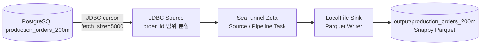
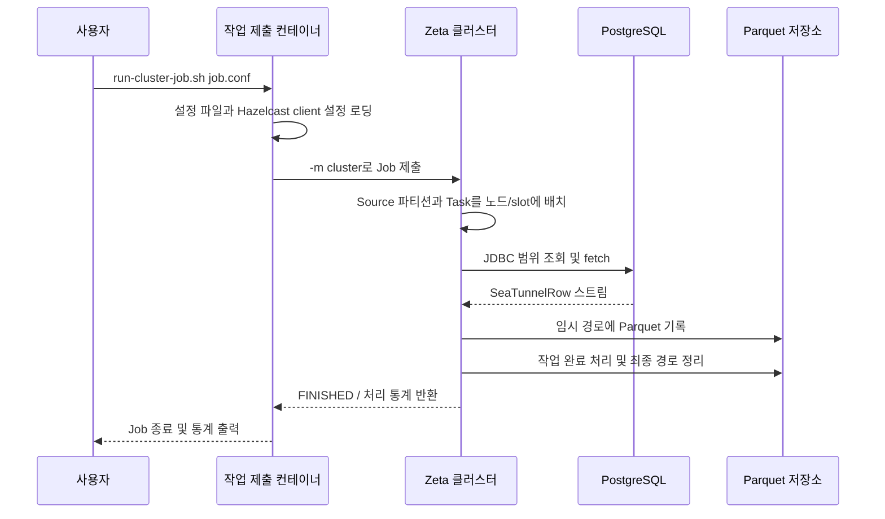
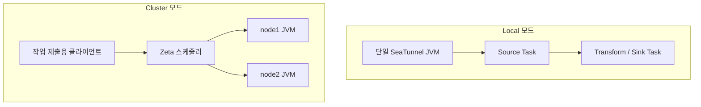

# Apache SeaTunnel 소개 및 클러스터 배치 실습

이 문서는 PostgreSQL 데이터를 Parquet으로 이관한 실습을 바탕으로 Apache SeaTunnel의 기본 개념, Zeta 실행 엔진, Docker 구성, 일반 배치, 대용량 클러스터 배치 흐름을 설명한다.

실습에서 사용한 SeaTunnel 버전은 **2.3.13**이며, 실행 엔진은 Apache Spark가 아닌 **SeaTunnel Engine(Zeta)**이다.

---

## 1. SeaTunnel 소개

Apache SeaTunnel은 서로 다른 시스템 사이에서 데이터를 읽고, 필요한 변환을 수행한 뒤, 다른 저장소로 전달하는 데이터 통합 도구다.

대표적인 사용 사례는 다음과 같다.

- PostgreSQL/MySQL 등 관계형 데이터베이스 마이그레이션
- 데이터베이스에서 Parquet, S3, MinIO, HDFS 등 파일·오브젝트 저장소로 이관
- CDC 기반 실시간 데이터 동기화
- 여러 데이터베이스와 메시징 시스템 사이의 EL/ETL 파이프라인
- 대규모 배치 데이터 이동

SeaTunnel은 사용자가 Source, Transform, Sink를 설정 파일로 선언하면 내부 엔진과 커넥터가 실제 읽기·변환·쓰기 작업을 수행하는 구조다.

```text
Source  ─────►  Transform  ─────►  Sink
 데이터 읽기       데이터 변환       데이터 저장
```

---

## 2. Source–Transform–Sink 개념

### Source

데이터를 읽는 시작점이다.

예시:

- JDBC로 PostgreSQL/MySQL 읽기
- Kafka 메시지 읽기
- CSV/JSON/Parquet 파일 읽기
- PostgreSQL-CDC, MySQL-CDC로 변경 로그 읽기

### Transform

Source에서 읽은 데이터를 Sink로 보내기 전에 가공하는 단계다.

예를 들어 SQL Transform으로 컬럼을 대문자로 바꾸거나 조건을 적용할 수 있다.

```hocon
transform {
  Sql {
    plugin_input = "production_orders"
    plugin_output = "production_orders_upper"
    query = "SELECT order_id, factory_id, UPPER(product_name) AS product_name, quantity, order_date, status FROM production_orders"
  }
}
```

### Sink

처리한 데이터를 저장하는 목적지다.

예시:

- PostgreSQL/MySQL JDBC Sink
- LocalFile Parquet Sink
- S3/MinIO 파일 Sink
- Iceberg, Kafka 등

Sink의 특성에 따라 CDC 변경을 실제로 적용할 수 있는지, 변경 이력을 append할 수 있는지가 달라진다.

---

## 3. 실행 엔진: Zeta, Flink, Spark

SeaTunnel은 파이프라인 정의와 커넥터를 실행 엔진과 분리한다. 같은 Source–Transform–Sink 개념을 SeaTunnel Engine(Zeta), Apache Flink, Apache Spark 중 하나에서 실행할 수 있다.

| 엔진 | 특징 | 적합한 경우 |
|---|---|---|
| SeaTunnel Engine(Zeta) | SeaTunnel 자체 엔진, 별도 빅데이터 플랫폼 없이 실행 가능 | 새 프로젝트, DB 동기화, CDC, 일반 배치 |
| Apache Flink | 스트리밍과 상태 관리에 강점 | 기존 Flink 클러스터가 있는 경우 |
| Apache Spark | 대규모 배치와 Spark 생태계 연계 | 기존 Spark/YARN/Kubernetes 환경이 있는 경우 |

이번 실습에서는 **Zeta 엔진**을 사용했다.

- Docker만으로 로컬 및 클러스터 실습이 가능하다.
- PostgreSQL 배치 이관과 CDC 실습에 적합하다.
- 별도의 Spark 클러스터나 YARN을 구축하지 않아도 된다.
- `-m local`은 단일 프로세스 실행이고, `-m cluster`는 실행 중인 Zeta 클러스터에 작업을 제출한다.

현재 사용한 명령은 Spark 모드가 아니다.

```bash
./bin/seatunnel.sh --config /jobs/job.conf -m cluster
```

위 명령의 `cluster`는 **SeaTunnel Zeta cluster mode**를 의미한다.

SeaTunnel 2.3.13 공식 문서 기준으로 CDC는 Zeta와 Flink만 지원하며, Spark 엔진은 CDC를 지원하지 않는다(권장하지 않는 수준이 아니라 미지원). 이 프로젝트가 실제로 쓰는 `Postgres-CDC` 커넥터 문서에도 지원 엔진으로 Zeta·Flink만 나열되어 있다. Spark 엔진 사용 시 사전 설치·설정 요구사항과 CDC 미지원의 상세 근거는 `docs/seatunnel-spark-engine-and-cdc-limits.md`를 참고한다.

- [SeaTunnel 2.3.13 Engine Overview](https://seatunnel.apache.org/docs/2.3.13/engines/overview/)
- [SeaTunnel With Spark](https://seatunnel.apache.org/docs/engines/spark/)

---

## 4. 실습 환경과 Docker 구성

실습에서는 Rancher Desktop이 제공하는 Docker 환경에서 PostgreSQL과 SeaTunnel을 실행했다.

```text
내 Mac
└─ Rancher Desktop
   └─ Docker
      ├─ seatunnel_practice_postgres
      ├─ seatunnel_practice_mysql
      └─ apache/seatunnel:2.3.13
```

PostgreSQL은 Docker 호스트의 `5440` 포트와 컨테이너의 `5432` 포트를 연결했다. SeaTunnel 컨테이너는 PostgreSQL 컨테이너와 동일한 `seatunnel_default` 네트워크에 연결되어 컨테이너 이름으로 데이터베이스에 접근한다.

```text
호스트: localhost:5440
컨테이너 네트워크: postgres:5432
```

SeaTunnel 실행용 Docker 컨테이너에는 다음과 같은 폴더를 마운트했다.

```text
호스트 jobs/   ──► 컨테이너 /jobs       (read-only)
호스트 output/ ──► 컨테이너 /output     (Parquet 결과 저장)
```

컨테이너 이미지에는 SeaTunnel 실행에 필요한 Java 런타임, `bin/seatunnel.sh`, 엔진 라이브러리와 커넥터 JAR가 들어 있다. 사용자가 작성한 셸 스크립트는 Java 기반 SeaTunnel 프로그램을 직접 구현하는 것이 아니라, Docker 컨테이너를 준비하고 설정 파일을 넘겨 SeaTunnel을 실행하는 역할을 한다.

---

## 5. SeaTunnel의 EL/ETL 처리 방식

### 5.1 사용자가 작성하는 부분

사용자는 보통 다음을 설정 파일에 작성한다.

- Source 접속 정보와 읽을 테이블/쿼리
- Transform 규칙
- Sink 접속 정보와 저장 경로
- 실행 모드와 병렬 처리 옵션

```hocon
env {
  parallelism = 1
  job.mode = "BATCH"
}

source {
  Jdbc {
    ...
  }
}

transform {
  Sql {
    ...
  }
}

sink {
  LocalFile {
    ...
  }
}
```

### 5.2 컨테이너 내부 처리

```text
docker run
   │
   ▼
./bin/seatunnel.sh
   │
   ▼
Java JVM 프로세스
   │
   ├─ 설정 파일 파싱
   ├─ 커넥터 JAR 로딩
   ├─ Source Task 생성
   ├─ Transform 처리
   ├─ Sink Task 생성
   └─ 체크포인트/상태/완료 처리
```

SeaTunnel 내부에는 JDBC, LocalFile, CDC 등 커넥터 구현이 Java JAR 형태로 포함되어 있다. JVM 안에서 엔진과 커넥터가 실행되며, 레코드는 SeaTunnel의 공통 내부 레코드 형식으로 Source에서 Transform과 Sink로 전달된다.

따라서 사용자는 일반적으로 JDBC ResultSet을 직접 읽거나 Parquet writer를 직접 작성하지 않는다. 설정과 실행 환경을 정의하고, 실제 데이터 처리는 SeaTunnel 엔진과 커넥터가 담당한다.

---

## 6. 일반 배치: PostgreSQL 200만 행 → Parquet

`jobs/01_postgres_to_parquet.conf`는 PostgreSQL의 `production_orders` 테이블을 읽어 로컬 Parquet 파일로 저장하는 기본 배치 작업이다.

```text
PostgreSQL
  production_orders
       │
       │ JDBC Source
       ▼
SeaTunnel Zeta
  ├─ JDBC Reader
  ├─ 선택적 SQL Transform
  └─ SeaTunnelRow 전달
       │
       │ LocalFile Sink
       ▼
output/production_orders/*.parquet
```

설정의 핵심은 다음과 같다.

```hocon
env {
  parallelism = 1
  job.mode = "BATCH"
}
```

- `job.mode = "BATCH"`: 유한한 데이터를 읽고 작업이 끝나면 종료
- `parallelism = 1`: 기본적으로 하나의 병렬 작업으로 실행
- `fetch_size = 5000`: JDBC 결과를 일정량씩 가져오도록 설정
- `file_format_type = "parquet"`: 결과를 Parquet 형식으로 기록
- `compress_codec = "snappy"`: Snappy 압축 사용

`quantity >= 5` 같은 조건은 Source의 JDBC `query` 또는 Transform의 SQL에 넣을 수 있다.

```sql
SELECT order_id, factory_id, UPPER(product_name) AS product_name,
       quantity, order_date, status
FROM production_orders
WHERE quantity >= 5
```

Source query에 조건을 넣으면 PostgreSQL이 먼저 필터링하므로 SeaTunnel로 전송되는 행이 줄어든다. Transform에 조건을 넣으면 Source에서 읽은 레코드를 SeaTunnel 파이프라인 중간에서 필터링한다.

---

## 7. 대용량 배치: 2억 행 PostgreSQL → Parquet

### 7.1 작업 개요

실습에서는 약 2억 행, 약 18~20GB 규모의 PostgreSQL 테이블을 Parquet으로 저장했다.

사용한 설정의 핵심은 다음과 같다.

```hocon
env {
  parallelism = 8
  job.mode = "BATCH"
}

source {
  Jdbc {
    partition_column = "order_id"
    partition_lower_bound = 1
    partition_upper_bound = 200000000
    partition_num = 8
    fetch_size = 5000
  }
}
```



### 7.2 `partition_num`과 `parallelism`

두 설정은 서로 다른 의미를 가진다.

| 설정 | 의미 |
|---|---|
| `partition_num = 8` | JDBC Source가 `order_id` 범위를 몇 개의 읽기 파티션으로 나눌지 결정 |
| `parallelism = 8` | 파이프라인 작업이 동시에 실행될 수 있는 병렬도 |
| `fetch_size = 5000` | JDBC ResultSet에서 한 번에 가져오는 행의 단위 |

`partition_num = 8`은 8개의 읽기 작업을 만들 수 있다는 뜻이지, 8개의 노드나 8개의 JVM을 만든다는 뜻은 아니다.

개념적으로는 다음처럼 범위가 나뉜다.

```text
P1:      1 ~ 25,000,000
P2: 25,000,001 ~ 50,000,000
...
P8:175,000,001 ~ 200,000,000
```

실제 파티션 배치는 SeaTunnel 스케줄러가 클러스터의 노드와 사용 가능한 slot을 기준으로 결정한다.

### 7.3 `run-cluster-job.sh` 실행 흐름



스크립트의 핵심 명령은 다음과 같다.

```bash
docker run --rm --network seatunnel_default \
  -v "$(pwd)/jobs:/jobs:ro" \
  -v "$(pwd)/output:/output" \
  -v "$(pwd)/cluster/hazelcast-client.yaml:/opt/seatunnel/config/hazelcast-client.yaml" \
  --entrypoint sh \
  apache/seatunnel:2.3.13 \
  -c "./bin/seatunnel.sh --config /jobs/$CONFIG_NAME -m cluster"
```

각 옵션의 의미는 다음과 같다.

- `--rm`: 작업 제출용 임시 컨테이너를 종료 후 삭제
- `--network seatunnel_default`: PostgreSQL과 SeaTunnel 노드가 같은 Docker 네트워크를 사용
- `-v jobs:/jobs:ro`: 설정 파일을 컨테이너에 읽기 전용으로 전달
- `-v output:/output`: Parquet 결과를 호스트에서 확인할 수 있도록 연결
- `hazelcast-client.yaml`: 실행 중인 Zeta 클러스터에 접속하기 위한 클라이언트 설정
- `-m cluster`: 독립 실행이 아니라 기존 Zeta 클러스터에 Job 제출

### 7.4 노드와 JVM의 관계

```text
작업 제출용 클라이언트 JVM
             │
             ▼
     Zeta 클러스터 스케줄러
        ┌────┴────┐
        ▼         ▼
 node1 JVM     node2 JVM
```

Local 모드에서는 작업 제출과 데이터 처리가 하나의 SeaTunnel 프로세스에 함께 들어간다.

Cluster 모드에서는 작업 제출용 클라이언트와 Zeta 실행 노드가 분리된다. 각 노드는 독립 JVM이므로 노드별 heap과 CPU를 별도로 사용할 수 있다.

단, `partition_num = 8`이나 노드가 2개라는 사실만으로 작업이 두 노드에 균등하게 배치되는 것은 아니다. 실제 배치는 다음에 따라 달라진다.

- 노드별 slot 수
- 동적 slot 할당 상태
- 파티션 수와 작업 생성 수
- 작업 제출 당시의 클러스터 상태
- Source/Sink 병렬도

따라서 PPT에서는 “2노드 클러스터에 Job을 제출했다”고 표현하되, 노드별 처리량 로그를 확인하지 않았다면 “각 노드가 정확히 절반씩 처리했다”고 표현하지 않는다.

### 7.5 실제 실행 로그

최신 실행 로그에서 확인된 내용은 다음과 같다.

```text
SeaTunnel version: 2.3.13
Engine mode: cluster
Cluster members: 2
  seatunnel-node1
  seatunnel-node2

Job mode: BATCH
parallelism: 8
partition_num: 8
fetch_size: 5000

Total Read Count: 200,000,000
Total Write Count: 200,000,000
Total Failed Count: 0
Job state: FINISHED
Total Time: 431 seconds
```

이 로그로 확정할 수 있는 결론:

- 두 개의 Zeta 노드가 클러스터 멤버로 연결되었다.
- Job이 정상적으로 실행되었다.
- 2억 행을 읽었다.
- 2억 행을 기록했다.
- 실패 건수는 0건이다.
- Job 상태는 `FINISHED`다.

이 로그만으로 확정할 수 없는 내용:

- node1과 node2가 각각 몇 개의 파티션을 처리했는지
- 각 노드가 각각 몇 행을 처리했는지
- 두 노드가 균등하게 작업을 나누었는지

노드별 분산을 설명하려면 각 노드 로그나 SeaTunnel 모니터링 지표를 함께 확인해야 한다.

### 7.6 Local 모드와 Cluster 모드



| 구분 | Local | Cluster |
|---|---|---|
| 실행 프로세스 | 하나의 SeaTunnel 프로세스 | 작업 제출 클라이언트와 여러 Zeta 노드 |
| 리소스 | 하나의 JVM heap 공유 | 노드별 JVM heap과 CPU 분리 가능 |
| 클러스터 필요 여부 | 불필요 | 사전에 Zeta 노드 실행 필요 |
| 실행 명령 | `-m local` | `-m cluster` |
| 확장성 | 단일 머신 중심 | 노드와 slot 추가 가능 |

Cluster 모드는 메모리와 실행 프로세스를 분리할 수 있어 Local 모드보다 대용량 처리에 유리할 수 있다. 그러나 노드 수가 많다고 자동으로 동일한 비율로 분산되는 것은 아니며, 실제 작업 배치는 스케줄러와 slot 상태에 의해 결정된다.

---

## 발표에서 전달할 핵심 메시지

1. SeaTunnel은 Source–Transform–Sink를 설정 파일로 선언하는 데이터 통합 도구다.
2. 실제 데이터 처리는 Java 기반 엔진과 커넥터 JAR가 JVM 안에서 수행한다.
3. 이번 실습은 Spark가 아니라 SeaTunnel 자체 엔진인 Zeta를 사용했다.
4. 일반 배치는 PostgreSQL → JDBC Source → 선택적 Transform → Parquet Sink 흐름으로 동작한다.
5. 대용량 처리를 위해 JDBC 범위를 `partition_num`으로 나누고 `parallelism`과 `fetch_size`를 조절했다.
6. Cluster 모드는 작업 제출용 클라이언트와 Zeta 실행 노드를 분리한다.
7. 2노드 클러스터를 구성했다고 해서 모든 작업이 반드시 두 노드에 균등하게 배치되는 것은 아니다.
8. 최신 실행은 2억 행 read/write, 실패 0건, `FINISHED`, 431초로 완료되었다.

---

## 참고 자료

- [SeaTunnel 2.3.13 Engine Overview](https://seatunnel.apache.org/docs/2.3.13/engines/overview/)
- [SeaTunnel 2.3.13 Architecture Overview](https://seatunnel.apache.org/docs/2.3.13/architecture/overview/)
- [SeaTunnel Engine Quick Start](https://seatunnel.apache.org/docs/2.3.13/getting-started/locally/quick-start-seatunnel-engine/)
- [SeaTunnel With Spark](https://seatunnel.apache.org/docs/engines/spark/)
