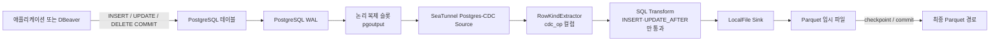

# SeaTunnel CDC 실습 발표 자료

이 문서는 SeaTunnel CDC 실습을 설명하고 PPT를 수정할 때 사용할 기술 인계 자료다. PPT 자체는 이 문서 작성에서 수정하지 않는다.

## 발표용 핵심 결론

> `run-cdc-job.sh`가 CDC 설정을 실행하면 장시간 실행되는 SeaTunnel Streaming 잡이 시작된다. 잡은 PostgreSQL의 WAL을 논리 복제 연결로 계속 수신하고, 새 INSERT·UPDATE·DELETE 이벤트가 커밋될 때 Source → Transform → Sink로 전달한다. 이벤트가 없을 때도 잡은 `RUNNING` 상태로 대기한다.

여기서 WAL은 **PostgreSQL Write-Ahead Log**다. “SeaTunnel WAL” 또는 “SeaTunnel이 테이블을 계속 조회한다”라고 표현하지 않는다. PostgreSQL이 변경 내용을 WAL에 기록하고, SeaTunnel의 `Postgres-CDC` 커넥터가 논리 복제 슬롯을 통해 변경 스트림을 받는다.

## 이번 15번 실습의 구성

실행 명령:

```bash
./scripts/run-cdc-job.sh jobs/15_postgres_10m_cdc_insert_update.conf
```

`run-cdc-job.sh`는 다음 작업을 한다.

1. `apache/seatunnel:2.3.13` 컨테이너를 `-d`로 백그라운드 실행한다.
2. `jobs/`와 `output/`을 컨테이너에 마운트한다.
3. `seatunnel.sh --config ... -m local`로 Local 모드에서 잡을 제출한다.
4. 컨테이너 이름은 `st_cdc_15_postgres_10m_cdc_insert_update`다.

설정의 중요한 값:

```hocon
env {
  parallelism = 1
  job.mode = "STREAMING"
  checkpoint.interval = 3000
}

source {
  Postgres-CDC {
    startup.mode = "latest"
    slot.name = "seatunnel_cdc_10m_iu_test"
    decoding.plugin.name = "pgoutput"
  }
}
```

- `STREAMING`: 잡이 유한한 입력을 모두 읽고 종료하지 않고 계속 실행한다.
- `startup.mode = "latest"`: 잡 시작 시점 이후의 변경을 주로 받는다. 이미 사용한 슬롯과 체크포인트가 있으면 저장된 offset에서 재개할 수 있으므로 재시작 동작은 별도로 검증한다.
- `checkpoint.interval = 3000`: 약 3초 간격으로 상태와 커밋 절차를 진행한다. 이벤트가 없어도 체크포인트 로그가 주기적으로 나온다.
- `slot.name`: PostgreSQL 논리 복제 슬롯 이름이다. 동시에 사용하는 CDC 잡마다 고유하게 지정한다.

## 이벤트 처리 흐름



SeaTunnel이 이벤트가 없을 때 하는 일은 WAL 연결과 체크포인트 상태를 유지하는 것이다. 새 이벤트가 커밋되면 WAL 스트림으로 전달되고, 이벤트가 없으면 새 행 처리 카운터가 증가하지 않는다.

## 이번 이벤트 SQL과 예상 결과

파일: `tests/manual/cdc_10m_events.sql`

- 50000000~50000199 INSERT 200건
- 50000000~50000099 UPDATE 100건
- 50000150~50000199 DELETE 50건
- 세 작업은 각각 `BEGIN`/`COMMIT`으로 분리했다.

Postgres-CDC가 읽는 RowKind 수:

| DB 작업 | CDC 레코드 |
|---|---:|
| INSERT 200 | 200 (`INSERT`) |
| UPDATE 100 | 200 (`UPDATE_BEFORE` + `UPDATE_AFTER`) |
| DELETE 50 | 50 (`DELETE`) |
| 합계 | **450** |

15번의 SQL Transform은 `cdc_op IN ('INSERT', 'UPDATE_AFTER')`만 통과시킨다. 따라서 LocalFile Sink가 쓰고 커밋하는 결과는 **300건**이다.

| 지표 | 의미 | 이번 결과 |
|---|---|---:|
| `Read Count So Far` | Source가 읽은 모든 CDC 레코드 | 450 |
| `Write Attempt Count So Far` | Transform을 통과해 Sink에 쓰려 한 레코드 | 300 |
| `Write Committed Count So Far` | Parquet 커밋까지 완료한 레코드 | 300 |
| `Commit Rate` | Sink 커밋 비율 | 100% |

따라서 DB에서 실제 변경된 행 수 350건(200+100+50)과 CDC Source 레코드 450건, Parquet 결과 300건은 서로 다른 숫자다.

## 로그 캡처본 평가와 PPT 사용법

현재 `image/`에 있는 네 캡처는 CDC 잡의 상태 변화를 설명하는 증거 자료로 사용한다. 캡처 시각이 서로 다르므로 PPT에서는 실제 시각을 표시하고, 서로 다른 실행 시점을 하나의 연속 장면처럼 이어 붙이지 않는다.

### Image #1: 이벤트 전 상태

```text
Read Count So Far         : 0
Write Attempt Count So Far: 0
Write Committed Count So Far: 0
runningJobCount            : 1
```

**이벤트 전 대기 상태 캡처다.** CDC 잡은 실행 중이지만 아직 DB 이벤트가 없어 대기 중이라는 상태를 보여준다. `runningJobCount=1`, `failedJobCount=0`도 함께 보여서 잡이 죽은 상태가 아님을 설명할 수 있다.

권장 캡션:

> 이벤트 발생 전: CDC 잡은 RUNNING 상태로 WAL 변경을 기다리고 있으며 처리 건수는 0이다.

### Image #2: 이벤트 수신 직후 집계

```text
Read Count So Far         : 450
Write Attempt Count So Far: 300
Write Committed Count So Far: 0
Commit Rate               : 0.00%
Average Read Count         : 7/s
Average Write Attempt Count: 5/s
```

이 캡처는 이벤트가 Source와 Transform까지 도착했지만, 해당 통계 시점에는 Sink 커밋이 아직 완료되지 않았음을 보여준다. `Read=450`, `Write Attempt=300`만으로 최종 파일 커밋이 끝났다고 말하지 않는다. 뒤의 파일 rename 로그와 최종 집계 캡처를 함께 확인한다.

권장 캡션:

> 이벤트 수신 직후: CDC 레코드 450건을 읽고 300건이 Sink 쓰기 대상으로 전달됐으며, 커밋은 진행 중이다.

### Image #3: 처리 과정 상세 로그

`CheckpointCoordinator`, WAL offset commit, `rename file`이 함께 보인다.

**기술 설명이나 발표자 노트에 유용하다.** 통계 영역에는 아직 `Write Committed Count=0`, `Commit Rate=0.00%`가 보이지만, 아래 로그에는 같은 처리에 대한 WAL offset과 파일 rename이 나타난다. 통계 출력과 파일 커밋 로그가 항상 같은 순간에 갱신되는 것은 아니므로 이 화면만으로 실패라고 판단하지 않는다. 본문 슬라이드에는 필요한 줄만 확대해 사용한다.

- `wait checkpoint completed`: 체크포인트 완료
- `Committing offset LSN{...}`: 처리한 WAL 위치를 커밋하려는 단계
- `rename file ... .seatunnel-staging ... /output/cdc_10m_insert_update/...parquet finish`: 임시 Parquet 파일을 최종 경로로 확정
- 이후 체크포인트 번호가 459, 460, 461처럼 계속 증가: Streaming 잡이 종료되지 않고 다음 이벤트를 기다림

권장 캡션:

> 체크포인트마다 WAL offset과 파일 결과를 확정한다. 파일 rename은 데이터 병합이 아니라 임시 파일을 최종 경로로 커밋하는 과정이다.

### Image #4: 이벤트가 없는 다른 대기 구간

이 캡처도 `Read=0`, `Write Attempt=0`, `Write Committed=0`, `Commit Rate=N/A`인 `RUNNING` 상태를 보여준다. Image #1과 같은 의미의 유휴 대기 상태 자료다. 앞선 이벤트 처리가 끝났다고 단정하기보다, “이 통계 구간에는 새 CDC 이벤트가 없었다”라고 설명한다. 둘 다 넣을 필요가 없으면 하나는 본문에, 다른 하나는 부록에 둔다.

권장 캡션:

> 새 이벤트가 없는 통계 구간: 잡은 계속 실행 중이며 해당 구간의 읽기·쓰기 건수는 0이다.

### 화면 구성 추천

본문에는 Image #1(또는 Image #4)을 **이벤트 전/유휴 대기** 예시로 두고, Image #2와 Image #3을 **이벤트 수신·커밋 진행 중** 예시로 배치한다. 최종 성공 결과를 별도로 캡처할 수 있다면 `Write Committed Count=300`, `Commit Rate=100%` 화면을 마지막 단계로 추가한다. 현재 네 장만 사용할 때는 Image #3의 `rename ... finish`를 파일 커밋의 근거로 설명하고, Image #2·#3의 `Committed=0`을 최종 결과로 오해하지 않도록 한다. 캡처의 날짜와 시각은 실제 로그 시각 그대로 남긴다.

## DBeaver로 이벤트를 발생시키는 방법

DBeaver 실행도 가능하며 시연에는 편리하다. Docker 밖의 DBeaver는 다음 연결을 사용한다.

```text
Host: localhost
Port: 5440
Database: srcdb
User: demo
Password: demo
```

먼저 ID 중복을 확인한다.

```sql
SELECT count(*)
FROM public.cdc_demo_orders
WHERE order_id BETWEEN 50000000 AND 50000199;
```

결과가 0이면 `tests/manual/cdc_10m_events.sql` 전체를 실행한다. SQL의 `BEGIN`/`COMMIT`은 INSERT·UPDATE·DELETE를 별도의 확정 단위로 만들어 CDC가 각 변경을 읽을 수 있게 한다.

실행 후 로그는 다음 명령으로 본다.

```bash
docker logs -f st_cdc_15_postgres_10m_cdc_insert_update
```

## 잡 상태와 종료

정상 대기 상태에서 기대하는 내용:

- `Job ... turned from state ... to RUNNING`
- `runningJobCount : 1`
- `failingJobCount : 0`, `failedJobCount : 0`
- 이벤트가 없으면 `Read Count`, `Write Count`가 증가하지 않음
- 체크포인트 로그는 약 3초마다 계속 출력

정상적으로 이벤트를 처리한 뒤에도 Streaming 잡은 계속 실행된다. 시연이 끝나면 종료한다.

```bash
docker rm -f st_cdc_15_postgres_10m_cdc_insert_update
```

현재 래퍼는 자동 재시작 정책이 없고 `-m local`을 사용한다. 운영에서는 자동 재시작, 체크포인트 영속 저장, 복제 슬롯과 WAL 크기 모니터링, 영구 저장소, 파일 보관·compaction을 별도로 구성해야 한다.

## 발표에서 피할 표현

- “SeaTunnel이 WAL을 조회한다” → “PostgreSQL WAL을 논리 복제 스트림으로 받는다”
- “이벤트가 없으면 아무것도 실행되지 않는다” → “잡은 실행 중이며 연결·체크포인트를 유지하고 새 이벤트를 기다린다”
- “350건이 Parquet에 저장됐다” → “450 CDC 레코드를 읽고 필터를 통과한 300건을 커밋했다”
- “CDC가 최신 테이블을 Parquet으로 동기화한다” → “이번 15번은 INSERT와 UPDATE_AFTER 변경 이력을 Parquet에 누적한다”
- “WAL offset commit이면 파일도 항상 같은 순간에 확정된다” → “offset 체크포인트와 파일 커밋 절차가 연동되며 로그 시점은 각각 확인한다”

## Claude에게 전달할 PPT 수정 요청문

> CDC 슬라이드에는 먼저 `run-cdc-job.sh`가 Streaming 잡을 백그라운드에서 시작한다는 흐름을 보여주세요. 이후 PostgreSQL 테이블 변경이 PostgreSQL WAL과 논리 복제 슬롯을 거쳐 Postgres-CDC Source로 전달되고, RowKindExtractor와 SQL Transform을 거쳐 Parquet Sink로 기록되는 과정을 표현해주세요. 네 캡처를 실제 로그 시각 기준으로 배치하세요. Image #1 또는 Image #4는 이벤트가 없는 RUNNING/0건 대기 상태, Image #2는 Read 450·Write Attempt 300이지만 통계상 아직 Committed 0인 이벤트 수신 직후, Image #3은 WAL offset·checkpoint·임시 파일 rename으로 커밋이 진행되는 과정을 보여주는 자료입니다. 최종 성공 화면을 별도로 확보할 수 있다면 `Committed 300 / Commit Rate 100%`를 마지막 단계로 추가하세요. `350 DB rows`, `450 CDC records`, `300 Parquet rows`를 구분하고, 이번 15번은 DELETE를 Parquet에 저장하지 않는다는 점을 표시해주세요. 현재 실습은 Local 모드이며 운영 환경에서는 자동 재시작·체크포인트 영속화·복제 슬롯/WAL 모니터링이 필요하다는 범위도 짧게 덧붙여주세요.
