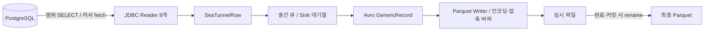

# SeaTunnel Local 힙·OOM 검증과 클러스터 발표 수정 근거

2026-09-15. SeaTunnel 2.3.13 / Zeta / PostgreSQL JDBC → LocalFile Parquet.

이 문서는 Claude에게 PPT 수정을 요청하기 위한 기술 인계 자료다. 앞부분은 발표용 쉬운 설명, 뒷부분은 실험 조건·원인 분석·로그 확인 방법이다. PPT 자체는 이 작업에서 수정하지 않았다.

Java·JAR 실행 구조, JVM 힙과 Docker 메모리 제한의 차이는 [Java 실행 구조와 JVM 힙](java-jvm-heap-and-seatunnel-oom.md)을 참고한다. OOM 배경 설명과 슬라이드용 발표 멘트를 함께 제공한다.

## 먼저 읽을 요약: 발표의 결론

> **이번 2억 행 작업은 Local에서도 힙을 3GB로 늘리면 성공했다. 클러스터가 필수였던 것은 아니다. 클러스터 실습에서는 하나의 잡을 여러 JVM에 배치하는 구조와 노드별 실행·파일 커밋을 확인했다.**

1. Local의 512MB는 기본 설정이며 변경할 수 있다.
2. 같은 P8 작업이 Local 512MB에서는 OOM, Local 3GB에서는 2억 행 전체 성공이었다.
3. DB를 조금씩 읽더라도 Parquet을 쓰는 쪽에서 Writer와 버퍼가 남아 메모리를 사용했다.
4. Cluster는 작업을 여러 JVM에 배치할 수 있게 한다. 각 JVM의 메모리 부족까지 자동으로 해결하지는 않는다.
5. 따라서 이번에 입증한 것은 **클러스터의 필요성**이 아니라 **Local의 메모리 부족 원인과 클러스터 실행·작업 배치 방법**이다.
6. 더 큰 작업에 대비해 클러스터 구조를 미리 실습했다는 의미도 있다. **향후 한 서버의 자원이나 요구 처리 시간에 한계가 생기면 다른 서버의 자원을 추가하는 구성을 검토한다.** 이 확장 효과는 이번에 측정한 결과가 아니라 다음 검증 과제다.

발표에서는 익숙한 표현인 512MB·3GB를 사용할 수 있다. JVM 옵션 `-Xmx512m`, `-Xmx3g`의 정확한 단위는 각각 512MiB, 3GiB이며, 아래 메모리 측정값에는 이 단위를 사용한다.

### 어려운 용어를 풀어서 설명하면

| 용어 | 쉬운 설명 |
|---|---|
| JVM | SeaTunnel의 Java 코드를 실행하는 프로세스 |
| 힙 | JVM이 처리 중인 객체와 버퍼를 담는 메모리 공간. 프로세스 전체 메모리와는 다름 |
| Writer | Parquet 파일을 쓰는 객체. 컨테이너나 JVM 하나를 뜻하지 않음 |
| 버퍼 | 파일로 기록하는 과정에서 데이터를 잠시 보관하는 공간 |
| GC | 더 이상 사용하지 않는 객체의 메모리를 회수하는 기능. 아직 참조 중인 객체는 없애지 못함 |
| 커밋 | 작성 결과를 최종 출력으로 확정하는 단계. 이번 파일 Sink에서는 파일 닫기와 최종 경로로 이동하는 절차가 포함됨 |

## 사용자가 물었던 질문과 쉬운 답변

### Q1. 결국 JVM 힙을 늘리면 되는 것인가?

**이번 작업에서는 그렇다.** Local 3GiB에서 전체 2억 행을 처리하고 커밋했다. 하지만 모든 OOM에 힙 증가가 정답이라는 뜻은 아니다. 다른 작업에서는 데이터·버퍼·동시 작업 수와 실패 종류를 따로 확인해야 한다.

발표용 설명:

> “데이터를 조금씩 읽었지만 파일을 쓰는 과정에서 메모리가 쌓였습니다. 512MB로는 부족했고, Local의 힙을 3GB로 늘린 조건에서는 성공했습니다.”

### Q2. 한 노드에서 힙을 늘리고 읽기 작업을 나누면 되는 것 아닌가?

**이번 작업은 그 방법으로 처리 가능했다.** Local에서도 읽기 범위를 나누고 여러 작업을 병렬 실행할 수 있다. 다만 두 비교 실험 모두 파티션 수와 병렬도는 이미 8이었다. 파티셔닝을 새로 추가해서 해결한 실험은 아니다.

| 구분 | 하는 일 | 이번 실험에서의 의미 |
|---|---|---|
| `partition_num=8` | DB에서 읽을 ID 범위를 8개 작업 조각으로 나눔 | 두 조건에 동일하게 적용 |
| `parallelism=8` | 처리 작업을 병렬로 구성 | Local에서도 사용 가능. 독립된 JVM 8개가 생기는 것은 아님 |
| `fetch_size=5000` | JDBC 커서가 행을 가져오는 단위 | 모든 행을 한 번에 읽지 않음. Sink 메모리 상한은 아님 |
| `-Xmx3g` | 한 JVM의 최대 힙 설정 | 이번 Local 성공 조건 |

### Q3. 그렇다면 왜 Cluster를 했다고 설명해야 하나?

처음에는 Local 실패 후 클러스터 구성을 시도했고, 그 과정에서 힙 설정도 바뀌었다. 당시 결과만으로는 **실행 모드 변경의 효과와 힙 증가의 효과를 분리할 수 없었다.** 추가 검증에서 Local 3GiB 성공을 확인했으므로 “클러스터가 있어야 성공했다”는 기존 해석은 수정한다. 과거 실패 자체의 원인은 당시 원본 로그·실제 옵션이 없어 소급 확정하지 않는다.

클러스터 실습의 의미는 다음 세 가지다.

- 하나의 잡에 속한 작업을 여러 서버 JVM에 배치하는 실행 구조를 학습했다.
- 노드별 로그를 통해 실제 작업이 어디에서 실행됐는지 검증했다.
- 여러 노드에서 파일을 쓰고 커밋할 때 공유 경로가 필요한 이유를 확인했다.

한 컴퓨터에서 필요한 시간 안에 안정적으로 처리할 수 있다면 Local도 충분한 선택이다. 한 컴퓨터의 자원이나 동시 처리 능력이 부족할 때 여러 서버 자원을 사용하는 Cluster를 검토할 수 있다. 다만 **이번 실습에서 여러 물리 서버의 성능 확장, 장애 복구, 고가용성까지 검증한 것은 아니다.**

### 이번 실습에서 향후 여러 서버로 확장하기까지

사용자가 발표에 담으려는 취지는 **“더 큰 작업에 대비해 클러스터 실행 방식을 미리 경험했다”**는 것이다. 이 방향은 적절하다. 다만 더 많은 데이터가 들어온다는 사실만으로 서버 추가가 반드시 필요해지는 것은 아니다. 같은 서버에서도 처리 시간을 더 허용하거나 메모리·Writer 동작을 조정해 처리할 수 있는 경우가 있다.

| 단계 | 구성과 목적 | 검증 상태 |
|---|---|---|
| 이번 Local 비교 | 한 JVM의 힙을 늘려 현재 2억 행 작업이 가능한지 확인 | **3GiB에서 성공 확인** |
| 이번 클러스터 실습 | Rancher Desktop의 한 Linux VM 안에 노드 2개 구성. 공통 CPU·RAM 자원 위에서 JVM별 힙은 분리 | **2억 행 처리와 노드별 작업 배치 확인** |
| 향후 여러 서버 확장 | 한 서버의 자원 또는 요구 처리 시간에 한계가 있을 때 다른 서버의 CPU·RAM까지 사용하도록 노드 배치 | **계획·검토 방향. 이번 실험에서는 미검증** |

“같은 VM에서 메모리를 공유한다”는 말은 VM에 할당된 RAM을 함께 사용한다는 뜻이다. 서로의 Java 객체가 들어 있는 힙을 직접 공유한다는 뜻은 아니다. 한 VM 안에 컨테이너만 추가하는 것과, 별도 서버를 추가해 사용할 수 있는 자원을 늘리는 것은 구분한다.

향후에는 데이터 규모뿐 아니라 목표 완료 시간, 동시 실행 잡 수, CPU·힙 사용량, DB 읽기와 파일 쓰기 속도를 관찰해 확장 필요성을 판단한다. 원본 DB나 저장소가 병목이면 SeaTunnel 노드를 추가해도 충분한 개선이 없을 수 있으므로, 노드 추가의 효과도 측정해야 한다.

여러 서버로 옮길 때는 현재의 동일 호스트 `output` 폴더 마운트만 그대로 복제하면 공유 저장소가 되지 않는다. 이번에 확인한 임시·최종 파일 접근 조건을 만족하는 공유 파일시스템 또는 적합한 외부 저장소 커넥터를 별도로 구성·검증해야 한다.

발표용 설명:

> “이번에는 Rancher Desktop의 한 VM 안에 두 노드를 구성해, 같은 CPU와 RAM을 사용하면서 클러스터의 작업 배치를 실습하고 2억 행을 처리했습니다. 추가 비교에서 이 데이터는 Local 3GB로도 처리 가능하다는 것을 확인했습니다. 클러스터 실습은 앞으로 더 큰 작업에 대응할 수 있는 실행 구조를 미리 경험한 것입니다. 향후 한 서버의 자원이나 목표 처리 시간에 한계가 생기면, 다른 서버의 자원을 추가해 클러스터를 확장하고 그 효과를 검증할 계획입니다.”

### Q4. 2억 행·약 20GB를 대용량이라고 표현해도 되나?

실습 규모를 설명하는 표현으로 사용할 수 있지만, “대용량이므로 클러스터가 필수”라는 연결은 하지 않는다. 제목은 **“2억 행 배치 처리 실습”**처럼 구체적인 규모를 쓰는 것이 가장 명확하다.

이전 DB 크기 기록은 테이블 약 14GB, 인덱스 포함 약 18GB였다. 약 18~20GB는 DB 저장 공간을 설명하는 대략적인 표현이며, 인덱스까지 Parquet으로 전송한 것은 아니다. 이번 Local 결과의 압축 Parquet은 약 1.56GB다. DB 저장 공간, 출력 파일 크기, 실행 중 힙 요구량은 서로 다른 수치다. 근거: [기존 배치 해설](200m-batch-execution-study.md).

## 클러스터 그림 해설 및 수정 지침

대상 그림: [image/seatunnel_cluster.png](../image/seatunnel_cluster.png).

### 그림의 핵심 구조는 맞다

```text
macOS
└─ Rancher Desktop Linux VM — 물리 자원을 사용하는 공통 실행 환경
   └─ Docker
      ├─ 컨테이너 1 → SeaTunnel 서버 JVM 1 → 독립된 힙, 최대 3GiB
      └─ 컨테이너 2 → SeaTunnel 서버 JVM 2 → 독립된 힙, 최대 3GiB
```

- 각 SeaTunnel 서버는 별도 JVM 프로세스로 실행되며 각자 힙을 관리한다.
- 두 서버는 통신하며 하나의 잡에 속한 작업을 나눠 수행할 수 있다. 관계없는 전체 잡을 각각 중복 실행한다는 뜻은 아니다.
- 3GiB + 3GiB가 하나의 6GiB 힙이 되지 않는다. 노드 1이 노드 2의 남는 힙을 직접 빌려 쓸 수 없다.
- 실제 CPU와 RAM은 같은 Linux VM의 자원이다. 컨테이너를 둘로 나눠도 물리 자원이 새로 생기지 않는다.
- 그림의 클러스터 점선은 두 서버의 논리적 연결이다. 클러스터라는 별도 데이터 처리 프로세스가 하나 더 있는 것은 아니다. 제출 클라이언트는 별도이며 그림의 두 서버 힙과 구분한다.

### “두 노드가 DB에서 직접 읽는다”의 근거와 범위

기존 Cluster P8 실행(Job ID `1151776238910570497`)의 검증 기록:

| 노드 | 실제 Source Task index | 관리·커밋 역할 |
|---|---|---|
| Node 1 | 0, 2, 4, 6 — 4개 | SplitEnumerator, JobMaster/Coordinator |
| Node 2 | 1, 3, 5, 7 — 4개 | AggregatedCommitter |

근거: [P8 검증 기록](200m-p8-verification.md). 각 노드의 TaskExecutionService 및 SourceSeaTunnelTask 시작 로그를 대조한 기록이다. 따라서 그림 하단의 두 노드가 DB를 읽는 흐름은 **이 P8 실행의 설명으로는 적절하다.** 단, Task 수가 같다고 노드별 처리량·메모리가 정확히 반반이라는 뜻은 아니다.

이전 P4 실행에는 읽기·쓰기 작업이 한 노드에 배치된 기록도 있다. 노드가 두 개라는 사실만으로 읽기가 항상 두 노드에 분산된다고 설명하지 않는다. 이번 Local 3GiB 실험과 기존 Cluster P8 검증은 서로 다른 실행이다.

### 그림 문구를 수정할 때

| 그림의 표현 | 수정 또는 설명 지침 |
|---|---|
| “하나의 잡을 두 JVM이 나누어 처리” | P8 실행 설명으로 유지 가능. 일반 구조 설명이라면 “하나의 잡을 여러 JVM에 나누어 배치 가능” |
| “독립된 힙 · 최대 3GB” | 유지. 고정 사용량이나 컨테이너 전체 메모리 제한이 아니라 최대 Java 힙임을 설명 |
| “CPU·RAM은 같은 VM의 자원을 사용” | 유지. 별도 물리 서버 두 대로 오해하지 않게 표시 |
| “각 노드가 DB에서 직접 읽기” | “P8 실행: 각 노드에 Reader 4개 배치”라는 설명을 붙이면 명확함 |
| “작업과 메모리 부담은 분산” | **“작업 배치에 따라 처리와 메모리 부담을 나눌 수 있음”**으로 수정 |
| 두 노드의 화살표가 하나의 Parquet 아이콘에 모임 | 최종 파일은 여러 개이며 이번에는 200개. 하나의 파일로 병합하는 그림으로 해석되지 않게 표시 |
| 파일 커밋 설명 | 파일을 최종 경로로 확정하는 절차. 이번 공유 경로에 접근 가능한 노드가 커밋 수행 |

발표자가 그림을 설명할 문장:

> “각 컨테이너에서 SeaTunnel이 별도 JVM으로 실행되고, 노드마다 최대 3GB의 독립된 힙을 사용합니다. 하나의 잡을 여러 작업으로 나눠 각 노드에 배치할 수 있습니다. 이번 P8 실행에서는 각 노드에 읽기 작업이 4개씩 배치됐습니다. 다만 같은 컴퓨터 안의 두 컨테이너이므로 실제 CPU와 RAM은 공유합니다.”

## 상세 검증의 범위

- Local의 512MiB는 모드의 한계가 아니라 이미지의 기본 최대 힙이다. `jvm_client_options`를 마운트하면 Local도 3GiB 등으로 변경할 수 있다.
- **Local 3GiB에서도 2억 행 전체가 227초에 성공했다.** Parquet 200개, 메타데이터 총 200,000,000행을 확인했다.
- 클러스터 구성과 분산 처리 실습은 유효하다. 다만 “20GB는 Local로 처리할 수 없으므로 Cluster가 필요하다”, “Cluster로 전환하면 OOM이 해결된다”는 결론은 성립하지 않는다.
- 이번 검증은 **현재 P8 설정의 재현 실험**이다. 과거 실패의 실제 옵션과 원본 로그가 없으므로 과거 사건까지 동일 원인이라고 확정하지 않는다.
- 두 노드는 같은 Rancher Desktop VM에 있는 컨테이너다. 서로 다른 물리 서버의 자원 확장 실험은 아니다.

## 실험 조건과 증거

원본 `jobs/12_postgres_200m_to_parquet_cluster.conf`를 복사하고 출력 경로만 실행별로 분리했다.

- `parallelism=8`, `partition_num=8`, `fetch_size=5000`
- PostgreSQL의 `production_orders_200m`, 기존 6개 컬럼
- `LocalFile`, `parquet`, `snappy`, 기본 파일 전환 단위 1,000,000행
- Local 모드, 이미지 OpenJDK 8u342
- 두 실험 모두 G1GC 및 GC 로그/힙 덤프를 활성화했다. **기존 Local 이미지 기본 GC까지 그대로 재현한 비교는 아니다.**
- 작은 힙: `-Xms256m -Xmx512m`; 큰 힙: `-Xms1g -Xmx3g`. 초기 힙도 다르므로 최대 힙만을 바꾼 엄밀한 성능 실험은 아니다.
- 두 실행을 순차 진행했다. 캐시, 진단 도구 정지 시간 등을 통제하지 않았으므로 성능 벤치마크로 사용하지 않는다.

증거 폴더: `output/oom-study/20260915/`.

| 조건 | 결과 |
|---|---|
| Local 512MiB / P8 | Java heap OOM 재현. 최초 실패 전 마지막 정기 통계는 읽기 43,145,109행, 쓰기 시도 43,141,796행, 커밋 0행 |
| Local 3GiB / P8 | FINISHED, 227초, 읽기/쓰기 200,000,000행, 실패 0, 종료 코드 0 |

512MiB Job ID: `1152132624165109761`. 실제 JVM의 `MaxHeapSize=536870912`를 `jcmd VM.flags`로 확인했다.

3GiB Job ID: `1152134530241396737`. 실제 JVM의 `MaxHeapSize=3221225472`를 확인했다. UTC 06:51:17 → 06:55:04. 결과는 Parquet 200개 × 1,000,000행, 1,558,402,577바이트이며 OOM과 Full GC 기록은 0건이다. `local-3g/validation.json`, `success-excerpt.log`에 결과를 보존했다. 파일의 메타데이터·스키마를 확인했으며 원본 DB와 모든 컬럼을 전수 대조하거나 전체 키의 누락·중복을 검사하지는 않았다.

이전 Cluster P8 431초와 이번 Local 227초는 서로 다른 시점의 실행이다. 이 숫자만으로 Local이 더 빠르거나 Cluster가 더 느리다고 일반화하지 않는다. 이번 실험이 확인한 것은 **Local 3GiB에서도 전체 처리와 커밋이 가능하다**는 사실이다.

첫 OOM은 UTC 06:49경 발생했다. 엔진에서 task/pipeline FAILED 및 재시도가 관측됐다. OOM 관측 후에도 실행이 남아 있어 실험 관리자가 로그를 복사하고 `docker stop -t 15`로 종료했다. 최종 컨테이너 exit=137, `OOMKilled=false`는 **이 수동 종료 결과**이며 OS OOM kill 증거가 아니다.

## 확인한 OOM 원인

### 1. 실제 오류

`local-512m/console.log`에 다음 스택이 남았다.

```text
java.lang.OutOfMemoryError: Java heap space
  at ...avro.data.RecordBuilderBase.<init>(RecordBuilderBase.java:62)
  at ...avro.generic.GenericRecordBuilder.<init>(GenericRecordBuilder.java:41)
  at ...file.sink.writer.ParquetWriteStrategy.write(ParquetWriteStrategy.java:123)
  at ...file.sink.BaseFileSinkWriter.write(...)
  at ...MultiTableWriterRunnable.run(...)
```

이는 Sink가 새 행을 Avro 레코드 객체로 바꾸는 도중 할당에 실패했다는 뜻이다. **할당에 실패한 코드가 기존 메모리를 가장 많이 보유한 코드라는 뜻은 아니다.** Source 쪽에서도 같은 힙 고갈로 OOM이 발생했고, 뒤에는 InterruptedException과 작업 취소 오류가 따라왔다.

### 2. 힙 덤프

OOM 시 자동 생성된 `local-512m/heap.hprof`를 분석했다.

- `ParquetWriteStrategy` 8개가 가진 `beingWrittenWriter` 맵의 크기: 8, 4, 4, 7, 5, 5, 6, 7.
- 합계 **ParquetWriter 46개**. 병렬도 8이 Writer 객체 총수의 상한이 아니었다.
- 이 Writer들에서 Parquet/압축/Java 컨테이너·버퍼 경로를 따라 도달 가능한 고유 `byte[]` 데이터: **387,625,985바이트, 약 369.7MiB**.
- 덤프 내 전체 `byte[]` 데이터는 393,481,917바이트. 주요 바이트 배열이 Writer 쪽에서 참조됨을 확인했다.
- 위 수치는 객체 헤더를 제외한 배열 데이터 길이 합이며, dominator 분석으로 계산한 독점 retained size는 아니다. 동일 배열은 한 번만 센다.

사용한 분석 코드: `tests/manual/oom-study/inspect_heap.py`. 결과: `local-512m/oom-heap-analysis.json`.

### 3. 왜 Writer가 46개인가?

2.3.13의 다음 경로를 공식 소스와 이미지의 ParquetWriteStrategy 바이트코드로 확인했다.

1. 100만 행을 채우면 `AbstractWriteStrategy.newFilePart()`가 part 번호를 올리고 파일 경로 맵을 비운다.
2. 다음 행에서 새 경로에 대한 `ParquetWriter`가 생성된다.
3. 이전 Writer는 `ParquetWriteStrategy.beingWrittenWriter`에 계속 남는다.
4. `finishAndCloseFile()`에서 보관된 Writer들을 닫고 맵을 비운다. `prepareCommit()`은 이 함수를 호출한다.
5. 이번 BATCH는 주기적 `checkpoint.interval`이 없고, 로그에도 checkpoint disabled가 기록돼 있다.

따라서 이 구성에서는 파일 전환만으로 이전 Writer의 모든 버퍼가 즉시 해제되지 않는다. 여러 파일의 Writer와 버퍼가 남는 동안 512MiB 힙의 여유가 소진됐다. GC로 살아 있는 객체를 제거할 수 없어 Full GC가 반복되고 결국 새 객체 할당에 실패했다.

“Source가 DB 20GB를 전부 한 번에 메모리에 올려서 실패했다”는 설명과 다르다. 반대로 “스트리밍으로 읽으니 전체 메모리는 항상 일정하다”는 설명도 이번 Sink에는 적용할 수 없다. 이 결론을 다른 파일 형식, 커넥터, 버전 전체로 일반화하지 않는다.

## 내부 처리 흐름



- `partition_num=8`: 숫자 ID 범위를 8개 split으로 분할한다. PostgreSQL 물리 파티션을 만드는 것이 아니다.
- `parallelism=8`: 처리 작업을 병렬로 구성한다. Local에서도 병렬 실행하며 같은 JVM 힙을 사용한다.
- JDBC는 `autoCommit=false`, `TYPE_FORWARD_ONLY`, `fetchSize=5000`으로 커서 기반 읽기를 한다. 2,500만 행씩 메모리에 가져오는 것이 아니다.
- 행은 `ResultSet → SeaTunnelRow → GenericRecord → Parquet`으로 변환된다. 중간 CSV/JSON/Avro 파일을 만들지 않는다.
- Sink 대기열이 차면 생산자가 기다리는 backpressure가 있다. 큐 제한은 Writer 내부 버퍼까지 제한하지 않는다.
- `Read Count`와 `Write Attempt Count`는 처리 진행량이다. `Write Committed Count=0`이면 아직 최종 커밋된 행이 없다는 뜻이다. 임시 파일이 생겼다고 성공으로 판정하지 않는다.
- Cluster는 작업을 여러 서버 JVM에 배치할 수 있다. 각 JVM의 힙은 독립적이며 합쳐진 하나의 힙이 아니다. 한 JVM에 큰 작업이 몰리면 그 JVM은 여전히 OOM이 날 수 있다.

## Local 힙을 3GiB로 바꾸는 방법

별도 JVM 옵션 파일에 다음 내용을 둔다.

```text
-Xms1g
-Xmx3g
-XX:+UseG1GC
```

현재 `scripts/run-job.sh`의 `docker run`에 아래처럼 파일 마운트를 추가하는 방식이다. 아래는 설명용이며 기존 래퍼는 이번 실험에서 수정하지 않았다.

```bash
-v "$(pwd)/cluster/jvm_client_options:/opt/seatunnel/config/jvm_client_options:ro" \
```

이때 `cluster/jvm_client_options` 파일을 위 내용으로 먼저 만들어야 한다. 기존 `cluster/jvm_options`는 서버용이다. Local의 `seatunnel.sh`는 `jvm_client_options`를 읽는다. Docker 메모리 상한만 늘려도 `-Xmx512m`가 자동으로 늘어나지는 않는다.

## 로그 확인 순서

### 1. 실행 위치와 Job ID 확인

Local: 실행 컨테이너에 실행 로그가 있다. Cluster: 제출 클라이언트 로그와 **각 서버 노드 로그**를 함께 본다.

```bash
docker logs --tail 200 seatunnel-node1
docker logs --tail 200 seatunnel-node2
docker logs -f seatunnel-node1
```

현재 일반 래퍼는 `--rm`을 사용한다. 종료 시 컨테이너와 내부 로그/덤프가 함께 사라질 수 있으므로, 진단 실행은 이름을 부여하고 `--rm`을 빼거나 로그·덤프 경로를 호스트에 마운트한다.

이번 실험은 stdout/stderr를 호스트 파일로 직접 리디렉션했다. 따라서 이 실험의 상세 로그는 `docker logs`보다 아래 파일을 읽는다.

```bash
tail -f output/oom-study/20260915/local-3g/console.log
rg -n -C 8 'OutOfMemoryError|Caused by:|ERROR|FAILED' \
  output/oom-study/20260915/local-512m/console.log
```

### 2. 오류 종류 구분

| 증거 | 해석 |
|---|---|
| `OutOfMemoryError: Java heap space` | Java 힙의 객체 할당 실패 |
| `GC overhead limit exceeded` | GC에 과도한 시간을 쓰지만 회수가 부족함 |
| `OutOfMemoryError: Metaspace` | 클래스 메타데이터 영역 부족. 힙 OOM과 별개 |
| `Direct buffer memory` | 직접 버퍼 메모리 문제. 힙 수치만으로 판단하지 않음 |
| `unable to create new native thread` | 스레드/네이티브 메모리/프로세스 제한 등을 확인 |
| `OOMKilled=true` | 컨테이너 프로세스의 OOM kill을 Docker가 기록함. 호스트/VM 메모리와 제한도 확인 |
| exit code 137만 있음 | SIGKILL 종료. 수동 kill도 가능하므로 OOM으로 단정 불가 |
| `InterruptedException`, `CANCELED` | 선행 실패로 인한 취소일 수 있음. 앞선 원인부터 확인 |

```bash
docker inspect <컨테이너명> \
  --format '{{json .State}} memory_limit={{.HostConfig.Memory}}'
```

### 3. 스택 읽기

처음 발생한 오류 시각, Job ID, TaskGroup ID, 스레드 이름, 예외 종류를 본다. 이어지는 `Caused by`를 끝까지 읽고, 해당 시각의 다른 작업/노드 오류도 대조한다. 동시 로그는 출력 순서가 시각 순서와 완전히 같지 않을 수 있다.

이번의 `st-multi-table-sink-writer-1`과 `ParquetWriteStrategy.write`는 파일 Sink 경로다. `SourceTask`라는 그룹 이름만 보고 DB 읽기 문제가 원인이라고 결론 내리면 안 된다. 서로 연결된 Source와 Sink 작업이 같은 그룹으로 실패할 수 있다.

### 4. 실제 힙과 GC 확인

```bash
docker exec <컨테이너명> jcmd -l
docker exec <컨테이너명> jcmd <Java_PID> VM.flags
docker exec <컨테이너명> jcmd <Java_PID> GC.heap_info
```

`MaxHeapSize`가 실제 `-Xmx`다. 설정 파일 내용만 보지 말고 실행 JVM을 확인한다. HealthMonitor의 `heap.memory.used/max`는 한 시점의 관측이며 90% 자체가 OOM 증거는 아니다. `heap.memory.total`은 현재 확보한 힙, `max`는 최대 힙이다.

이번 Java 8 이미지에서 사용한 진단 옵션:

```text
-XX:+HeapDumpOnOutOfMemoryError
-XX:HeapDumpPath=/study/local-512m/heap.hprof
-Xloggc:/study/local-512m/gc.log
-XX:+PrintGCDetails
-XX:+PrintGCDateStamps
```

경로는 쓰기 가능한 호스트 볼륨에 마운트한다. Java 9 이후의 `-Xlog:gc*` 구문은 이 Java 8 이미지에 그대로 쓰지 않는다.

```bash
rg -n 'Full GC|Allocation Failure|to-space exhausted' \
  output/oom-study/20260915/local-512m/gc.log
```

Full GC 전후 사용량이 거의 줄지 않고 반복되면 살아 있는 객체가 공간을 차지하고 있을 가능성이 있다. 힙 덤프에서 객체의 참조 경로를 조사해 확인한다. 이번에는 Writer 맵 → Parquet Writer → 버퍼 → byte[] 경로를 확인했다.

## Claude에게 전달할 PPT 수정 지침

### 발표의 중심 메시지

> **“2억 행 배치로 JVM 메모리 설정과 파일 Sink 동작을 검증하고, 더 큰 작업에 대비해 클러스터 실행 구조를 학습했다. 여러 서버의 자원을 추가하는 확장은 향후 필요성과 효과를 검증할 과제다.”**

발표자는 다음처럼 자연스럽게 설명할 수 있다.

> “처음에는 Local 실행에서 메모리 부족을 겪어 클러스터 구성을 실습했습니다. 이후 비교해보니, 이번 작업은 Local에서도 힙을 3GB로 늘리면 처리할 수 있었습니다. 클러스터 실습에서는 작업을 여러 JVM에 배치하는 구조와 노드별 실행·파일 커밋 과정을 확인했습니다.”

이어서 “이번 두 노드는 같은 VM의 자원을 사용했다”는 범위를 밝히고, 위의 **이번 실습에서 향후 여러 서버로 확장하기까지** 설명을 연결한다. “왜 클러스터를 했는가”에 대해 현재 작업의 필수 조건이었다고 주장하지 않고, 더 큰 작업에 대비한 실행 구조 학습과 향후 확장 방향으로 설명한다.

여기서 과거 Local 실패 경험과 이번 재현 실험은 구분한다. 과거 원본 로그가 없는 상태에서 이번 OOM 스택을 과거 실행의 원본 로그처럼 제시하지 않는다.

### 기존 주장과 바꿀 설명

| 수정 대상 주장 | 발표에 사용할 설명 |
|---|---|
| “대용량은 Cluster 모드로 실행하면 된다” | “Cluster는 작업을 여러 JVM에 배치하는 선택지다. JVM별 메모리와 작업 배치를 함께 확인해야 한다” |
| “2억 행·20GB는 Local로 처리할 수 없다” | “이번 2억 행 작업은 Local 3GB에서도 전체 처리에 성공했다” |
| “Cluster 전환으로 OOM을 해결했다” | “당시에는 모드와 힙을 함께 바꿨다. 추가 Local 비교에서 512MB 실패와 3GB 성공을 확인했다” |
| “20GB 전체가 512MB 힙에 들어가지 않아 실패했다” | “조금씩 읽었지만 파일을 쓰는 Writer와 버퍼가 남아 힙 여유가 소진됐다” |
| “파티션을 나누면 각 작업이 독립된 메모리를 쓴다” | “같은 JVM의 작업들은 힙을 공유한다. 독립된 힙은 별도 JVM에서 생긴다” |
| “두 노드가 정확히 절반씩 처리한다” | “P8에서 Reader는 4개씩 배치됐다. 처리량·메모리 사용량의 균등 분배까지 검증한 것은 아니다” |
| “파일을 모아 하나로 병합한다” | “이번 출력은 Parquet 200개이며, 커밋에서 파일을 최종 경로로 확정한다” |
| “227초 vs 431초이므로 Local이 더 빠르다” | “서로 다른 시점의 단일 실행 기록이다. 성능 우열의 결론에 사용하지 않는다” |
| “데이터가 더 커지면 반드시 서버를 추가해야 한다” | “한 서버의 자원이나 목표 처리 시간에 한계가 생기면 여러 서버로 확장하고 효과를 검증한다” |
| “이번 클러스터에서 두 서버의 자원을 합쳐 성능을 늘렸다” | “이번에는 한 VM의 자원을 사용하며 클러스터 구조를 실습했다. 별도 서버 자원 추가의 효과는 아직 검증하지 않았다” |

### 기존 PPT에 반영할 설명 순서

1. **실습 목표와 데이터**: PostgreSQL 2억 행 → Parquet. DB 저장 공간과 힙 요구량은 구분한다.
2. **처리 방식**: DB에서 조금씩 읽고 변환한 뒤 파일로 쓴다. 읽기 분할과 파일 쓰기 버퍼는 다른 문제다.
3. **Local 메모리 검증**: 같은 P8 작업의 512MB 실패 / 3GB 성공을 보여준다. 227초는 실행 기록으로 제시한다.
4. **원인의 쉬운 설명**: “파일을 쓰는 객체와 버퍼가 남아 작은 힙이 부족해졌다.” Writer 46개·약 370MiB는 이를 뒷받침하는 진단 수치다.
5. **Cluster의 의미와 구성**: 별도 JVM·독립된 힙, 실제 작업 배치, 같은 VM 자원 공유를 설명한다.
6. **향후 확장 방향**: “현재: 한 VM 안에서 클러스터 구조 실습” → “향후: 한 서버의 한계가 확인되면 여러 서버 자원으로 확장 검증”. 현재 성과와 향후 구상을 명확히 구분한다.
7. **실무에서 얻은 교훈**: 모드만 바꾸지 말고 실제 JVM 옵션, 오류 로그, 노드별 배치를 확인한다.

향후 구성을 그림으로 추가한다면 서버 A·서버 B 각각의 CPU/RAM과 SeaTunnel JVM을 표시하고 **“향후 확장 구상·미검증”**이라는 문구를 붙인다. 현재 구성도에는 같은 VM의 CPU/RAM 사용을 유지한다. 서버 수에 비례하는 속도 향상이나 자동 OOM 해결을 암시하는 수치는 넣지 않는다.

## PPT 8번 Flow Chart 검토

대상 슬라이드: `docs/slides/seatunnel-practice-share.pptx` 8번, 제목 **“SeaTunnel 내부 실행 흐름: conf → Parquet”**.

### 판정

Flow Chart의 주된 데이터 흐름은 **대체로 맞다**.

```text
docker run
  → seatunnel.sh
  → java 명령으로 JVM 시작
  → SeaTunnelClient(starter JAR)의 main 코드 실행
  → conf 파싱
  → 필요한 connector JAR 로드
  → Source Task
  → SeaTunnelRow
  → Sink Task / ParquetWriteStrategy
  → 임시 파일
  → 커밋 시 최종 경로로 rename
```

### Claude가 PPT에서 보완할 내용

1. `seatunnel.sh`가 JVM을 직접 구현하거나 JAR가 JVM을 부르는 것처럼 보이지 않게 한다. **셸 스크립트가 `java` 명령을 실행하고, JVM이 starter JAR 안의 SeaTunnelClient 코드를 로드해 실행한다.**
2. `Zeta Engine`은 JVM과 같은 계층이 아니다. **Zeta Engine은 JVM 위에서 실행되는 SeaTunnel의 엔진 코드**이며, 설정 파싱·작업 계획·Task 배치·상태 관리·커밋 조정을 담당한다.
3. Source·Transform·Sink Task와 JDBC/Parquet 커넥터도 JVM 프로세스 안에서 실행된다. **JAR마다 JVM이 하나씩 생기는 것은 아니다.** 한 JVM이 starter JAR와 여러 connector JAR를 함께 로드할 수 있다.
4. 힙을 별도 상자로 그릴 필요는 없지만, Local 흐름의 Zeta/Task 상자에 **“JVM 프로세스 내부에서 실행 · 처리 객체와 Writer 버퍼는 JVM 힙 사용”**이라는 한 줄을 추가하면 9번 OOM 설명과 연결된다.
5. `SeaTunnelRow`는 Source와 Sink 사이의 공통 레코드 표현이다. SQL Transform이 있는 기본 배치 예시라면 `Source → (SQL Transform) → Sink`를 표시하고, Transform이 없는 2억 행 잡이라면 생략했다고 명시한다.
6. `fetch_size=5000`은 JDBC가 결과를 가져오는 단위다. “전체 2억 행을 JVM에 적재하지 않고 커서로 조금씩 읽는다”는 설명은 유지한다. 이것만으로 Sink Writer의 힙 사용량이 제한되는 것은 아니다.
7. `tmp 경로 → rename → output`은 **파일 데이터를 하나로 병합하는 단계가 아니라, 커밋 시 완성된 파일을 최종 경로로 확정하는 단계**다. 이번 결과는 Parquet 200개다.
8. 슬라이드 마지막 문장 **“Spark/Flink로 바꾸면 이 안의 starter jar만 교체된다”는 표현은 수정한다.** 커넥터 API/구성을 재사용할 수 있다는 취지는 있지만, 엔진 변경에는 해당 엔진용 실행 스크립트·starter/runtime·배포 환경과 옵션 구성이 필요하다. Zeta 클러스터와 Spark/Flink 클러스터는 별도 실행 경로다.

권장 도식 문구:

> `seatunnel.sh`가 JVM을 시작하고 `SeaTunnelClient`를 실행한다. JVM 안에서 Zeta Engine이 conf를 해석하고 필요한 connector JAR를 로드해 Source·Transform·Sink Task를 실행한다. 처리 중인 행 객체와 Parquet Writer 버퍼는 해당 JVM의 힙을 사용한다.

슬라이드에서 너무 복잡해지면 JVM/힙 설명은 다음처럼 한 박스로 요약한다.

```text
Java 프로세스(JVM)
 ├─ SeaTunnelClient / Zeta Engine
 ├─ connector-jdbc.jar / connector-file-local.jar
 └─ 실행 중 객체·큐·Parquet Writer 버퍼 → JVM Heap
```

이 슬라이드는 “JAR 내부 구현”을 모두 보여주는 장이 아니라 **conf가 Java 프로세스와 Zeta 실행 계획을 거쳐 Source·Transform·Sink로 이어지는 구조**를 보여주는 장으로 유지한다. JVM·힙은 9번 OOM 비교 슬라이드의 원인을 이해할 만큼만 연결한다.

이는 설명 순서 제안이며 새 PPT나 정해진 슬라이드 수를 요구하는 것은 아니다. 기존 발표의 기본 배치·CDC 내용은 이 OOM 실험을 근거로 임의 변경하지 않는다. 이 실험은 JDBC 배치 → LocalFile Parquet에 대한 결과다.

### 본문과 상세 설명의 수준

- 발표 본문에는 쉬운 요약, 실험 결과 표, 클러스터 그림을 우선 사용한다.
- 긴 Java 클래스명, Job ID, 힙 덤프의 분석 방식, 실행 명령은 발표자 노트나 부록에 둘 수 있다.
- 본문에 비교 결과를 넣을 때는 “G1GC로 맞춘 재현 실험 / 성능 비교 목적 아님”을 짧게 표기한다.
- OOM의 약 4,300만 행은 최초 실패 전 정기 통계 기준이다. 정확한 한계 행 수로 표시하지 않는다.
- 약 370MiB는 Writer에서 참조 가능한 바이트 배열의 데이터 크기다. 전체 JVM 사용량이나 정확한 독점 메모리 크기로 표현하지 않는다.
- “3GB면 모든 데이터에서 안전”, “노드를 늘리면 OOM 해결”, “클러스터의 고가용성 검증 완료” 같은 확대 해석을 추가하지 않는다.

### 문서만 전달할 때 붙일 요청문

> 이 문서를 기술 근거로 기존 SeaTunnel PPT의 대용량 배치·OOM·클러스터 설명을 수정해주세요. 핵심은 Local 3GB에서도 2억 행 처리가 성공했으므로 클러스터가 필수였다는 주장을 수정하는 것입니다. 클러스터 실습의 의미는 여러 JVM의 독립된 힙, 실제 작업 배치, 공유 경로와 파일 커밋의 검증으로 설명해주세요. “왜 클러스터를 했는가”에는 더 큰 작업에 대비한 실행 구조 학습이라는 목적도 담아주세요. 현재는 Rancher Desktop의 한 VM 안에서 두 노드가 같은 CPU/RAM을 사용한 실습이고, 향후 한 서버의 자원이나 목표 처리 시간에 한계가 생기면 다른 서버 자원을 추가해 확장을 검증한다는 흐름을 보여주세요. 향후 구상은 미검증임을 표시하고, 데이터 증가만으로 서버 추가가 필수라고 단정하지 마세요. 실험 사실과 일반적인 설명을 구분하고, 성능 우열이나 장애 복구처럼 검증하지 않은 결론은 추가하지 마세요. 상세 기술 내용은 노트나 부록으로 옮기고 발표 본문은 쉬운 표현으로 정리해주세요.

## 확인할 증거 파일

아래 경로는 이 문서가 있는 `docs/` 기준의 상대 링크다. PPT에는 로그 전체보다 필요한 발췌를 사용한다.

| 확인할 내용 | 파일 |
|---|---|
| 실제 512MiB OOM과 스택 | [OOM 발췌 로그](../output/oom-study/20260915/local-512m/oom-excerpt.log) |
| 실패 전후·재시도 전체 흐름 | [512MiB 전체 로그](../output/oom-study/20260915/local-512m/console.log) |
| Writer 46개와 약 369.7MiB 배열 | [OOM 힙 분석 결과](../output/oom-study/20260915/local-512m/oom-heap-analysis.json) |
| Local 3GiB FINISHED·227초·2억 행 | [성공 발췌 로그](../output/oom-study/20260915/local-3g/success-excerpt.log) |
| Parquet 200개·2억 행 메타데이터 | [결과 검증 JSON](../output/oom-study/20260915/local-3g/validation.json) |
| 실제 JVM 힙 옵션 | [512MiB](../output/oom-study/20260915/local-512m/jvm-observed.txt), [3GiB](../output/oom-study/20260915/local-3g/jvm-monitor.txt) |
| 기존 Cluster P8 노드별 배치 | [P8 검증 기록](200m-p8-verification.md) |
| 검토한 클러스터 그림 | [seatunnel_cluster.png](../image/seatunnel_cluster.png) |

원본 설정과 기존 출력은 유지했고, 실험은 별도 출력 경로에서 진행했다. 일반 실행 래퍼의 기본 힙은 이번 실험에서 변경하지 않았다. 3GiB는 실험용 옵션 파일을 마운트한 실행 결과다.

## 공식 구현 근거

- [PostgresDialect 2.3.13](https://github.com/apache/seatunnel/blob/2.3.13/seatunnel-connectors-v2/connector-jdbc/src/main/java/org/apache/seatunnel/connectors/seatunnel/jdbc/internal/dialect/psql/PostgresDialect.java)
- [AbstractWriteStrategy 2.3.13](https://github.com/apache/seatunnel/blob/2.3.13/seatunnel-connectors-v2/connector-file/connector-file-base/src/main/java/org/apache/seatunnel/connectors/seatunnel/file/sink/writer/AbstractWriteStrategy.java)
- [ParquetWriteStrategy 2.3.13](https://github.com/apache/seatunnel/blob/2.3.13/seatunnel-connectors-v2/connector-file/connector-file-base/src/main/java/org/apache/seatunnel/connectors/seatunnel/file/sink/writer/ParquetWriteStrategy.java)
- [MultiTableSinkWriter 2.3.13](https://github.com/apache/seatunnel/blob/2.3.13/seatunnel-api/src/main/java/org/apache/seatunnel/api/sink/multitablesink/MultiTableSinkWriter.java)
- [Oracle Java 8 OOM 진단 안내](https://docs.oracle.com/javase/8/docs/technotes/guides/troubleshoot/memleaks002.html)

원본 소스 사본과 `parquet-javap.txt`도 증거 폴더에 보존했다.
